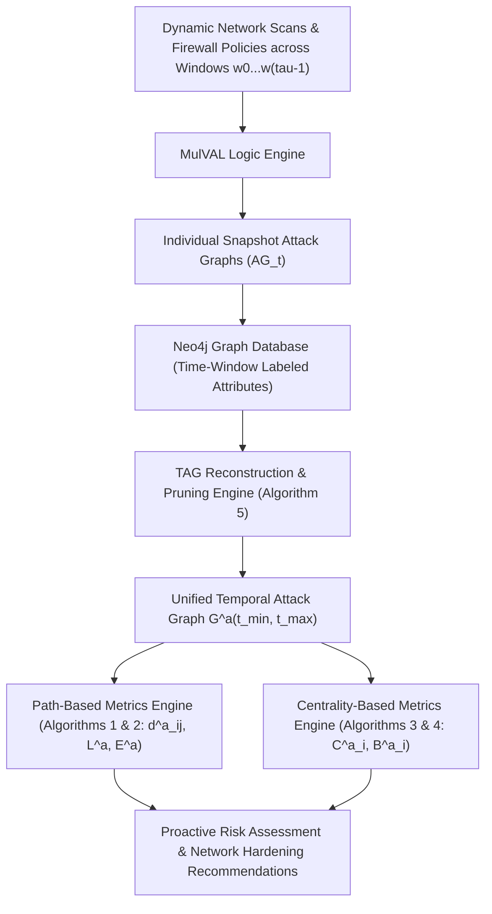

# Paper Summary: Temporal Attack Graph Based Security Metrics

- **Title**: Temporal Attack Graph Based Security Metrics
- **Authors**: Ayan Gain, Mridul Sankar Barik
- **Affiliation(s)**: Department of Computer Science & Engineering, Jadavpur University, Kolkata, West Bengal 700032, India
- **Publication**: *Computers & Security* (COSE), Manuscript Draft COSE-D-26-02785, Submitted May 23, 2026

---

## 1. Executive Summary

Enterprise networks are dynamic ecosystems characterized by evolving network topologies, soft configuration changes, ephemeral cloud services, and time-varying vulnerability windows. Traditional attack graph models (e.g., MulVAL, TVA) operate statically over a single snapshot of network state, failing to capture how vulnerability life cycles and temporal configuration changes impact an attacker's multi-stage progression over time. Existing dynamic approaches rely primarily on graph edit distance or maximum common subgraphs to measure structural changes between snapshots, but fail to explicitly model temporal dependencies and non-decreasing time window constraints governing actual attack propagation.

To address these limitations, this paper introduces **Temporal Attack Graphs (TAGs)** to formally incorporate the temporal dimension into vulnerability propagation modeling. A TAG models dynamic networks as a sequence of attack graph snapshots across discrete time windows $w_0, w_1, \ldots, w_{\tau-1}$. Building upon this temporal representation, the authors propose two main classes of novel security metrics: **Path-Based Metrics** (shortest temporal attack path length $d^a_{ij}$, characteristic path length $L^a$, and global efficiency $E^a$) and **Centrality-Based Metrics** (TAG-based Betweenness Centrality $\mathcal{B}^a_i$ and TAG-based Closeness Centrality $\mathcal{C}^a_i$).

The paper provides linear and polynomial time algorithms for metric computation ($O(\tau(N + |E|))$ for shortest paths and $O(|N||E|)$ for betweenness centrality), along with a Neo4j-based graph storage and pruning pipeline (Algorithm 5). Evaluated on synthetic topologies ranging from 39 to 498 hosts across 4 time windows, the experimental findings prove that temporal metrics capture critical bottleneck hosts and reachability dynamics that static attack graphs miss.

---

## 2. System / Model Architecture

The TAG generation, pruning, and metric calculation workflow follows a multi-stage pipeline:

### Pipeline Walkthrough
1. **Snapshot Generation**: Network configurations, firewall policies, and vulnerability scans are sampled at discrete time intervals $t_0, t_1, \ldots, t_{\tau-1}$. MulVAL generates independent static attack graph snapshots $AG_t$ for each window.
2. **Neo4j Loading & Unified TAG Assembly**: Individual graph snapshots are ingested into a Neo4j graph database, tagging edges with their active time window labels $w_0, w_1, \ldots, w_{\tau-1}$.
3. **Graph Pruning & Reconstruction (Algorithm 5)**: Leaf nodes and non-essential intermediate precondition nodes that do not enable further lateral movement are pruned while preserving reachability. This reduces graph density and computational complexity without altering temporal shortest paths.
4. **Metric Computation**:
   - *Path Engine*: Algorithm 1 computes shortest temporal distances $d^a_{ij}$ across windows; Algorithm 2 aggregates overall characteristic path length $L^a$ and efficiency $E^a$.
   - *Centrality Engine*: Algorithm 3 computes TAG Closeness Centrality $\mathcal{C}^a_i$; Algorithm 4 computes TAG Betweenness Centrality $\mathcal{B}^a_i$ using a modified temporal Brandes algorithm.

---

## 3. Formal Definitions & Mathematical Model

### 3.1 Temporal Attack Graph Model

#### Definition 1 (Temporal Attack Graph)
A **Temporal Attack Graph** $\mathcal{G}^a(t_{min}, t_{max})$ is defined as an ordered sequence of attack graphs:

$$\mathcal{G}^a(t_{min}, t_{max}) = (G_0, G_1, \ldots, G_{\tau-1})$$

where:
- $G_t = (V_t, E_t)$ is the attack graph snapshot $AG_t$ taken at time instance $t$.
- $\tau = \frac{t_{max} - t_{min}}{w} = |\mathcal{G}^a(t_{min}, t_{max})|$ is the number of time windows of duration $w$.
- The vertex set across all time windows is $|E \cup C| = \sum_{w=1}^\tau |E^w \cup C^w|$, where $E^w$ are exploit nodes and $C^w$ are security condition nodes.
- The edge set across all time windows is $|R_r \cup R_i| = \sum_{w=1}^\tau |R_r^w \cup R_i^w|$, where $R_r \subseteq C \times E$ and $R_i \subseteq E \times C$.

---

### 3.2 Temporal Attack Path & Shortest Distance

#### Definition 2 (Temporal Attack Path)
A **temporal attack path** $p^a_{ij}$ from host $i = n_0$ to host $j = n_{\eta-1}$ over $\mathcal{G}^a(t_{min}, t_{max})$ is a sequence of $\eta$ hops via distinct nodes:

$$p^a_{ij} = (n_0^{W_b}, n_1^{W_p}, \dots, n_{\eta-1}^{W_k}), \quad b \le p \le k$$

where node $n_h$ is visited if and only if there exists a valid edge between $n_{h-1}$ and $n_h$ at time window $W_b \le W_p$.

- $Q^a_{ij}$: Set of all temporal attack paths between $i$ and $j$. If no path exists, $Q^a_{ij} = \emptyset$.

#### Shortest Temporal Attack Path Length ($d^a_{ij}$)
The minimum number of hops among all feasible paths in $Q^a_{ij}$:

$$d^a_{ij} = \min\Big( \left| D^a(p^a_{ij}) \right| \Big), \quad \forall\, p^a_{ij} \in Q^a_{ij}$$

where $D^a(p^a_{ij})$ returns the set of nodes in path $p^a_{ij}$. If $i$ and $j$ are temporally disconnected, $d^a_{ij} = \tau$ (or $\infty$).

- $S^a_{ij}$: Set of all shortest temporal attack paths from $i$ to $j$:
  
  $$S^a_{ij} = \{ p^a_{ij} \in Q^a_{ij} \mid |D^a(p^a_{ij})| = d^a_{ij} \}$$

---

### 3.3 Simplifying Privilege Persistence Assumption

#### Axiom / Assumption (Capability Persistence)
When an attacker exploits a vulnerability and gains root/user access on a host/server/workstation, even if that vulnerability is patched in a subsequent time window, the attacker **maintains the acquired capabilities and privileges** acquired earlier:

$$\text{access}(host, t) = \text{granted} \implies \text{access}(host, t') = \text{granted} \quad \forall\, t' \ge t$$

---

### 3.4 Path-Based Security Metrics

1. **Characteristic Temporal Attack Path Length ($L^a$)**:
   Measures the average temporal attack distance across all host pairs in the network:

   $$L^a = \frac{1}{N(N-1)} \sum_{i \ne j} d^a_{ij}$$

   where $N = |V^a|$ is the total number of unique hosts across all time windows.

2. **Temporal Attack Global Efficiency ($E^a$)**:
   Measures network vulnerability efficiency (prevents divergence for disconnected host pairs):

   $$E^a = \frac{1}{N(N-1)} \sum_{i \ne j} \frac{1}{d^a_{ij}}$$

---

### 3.5 Centrality-Based Security Metrics

1. **TAG-Based Betweenness Centrality ($\mathcal{B}^a_i$)**:
   Quantifies the structural importance of host $i$ as a bottleneck along temporal shortest attack paths:

   $$\mathcal{B}^a_i = \frac{1}{(N-1)(N-2)} \sum_{\substack{j \in V^a \\ j \ne i}} \sum_{\substack{k \in V^a \\ k \ne i \\ k \ne j}} \frac{U(i, \tau, j, k)}{|\sigma^a_{j,k}|}$$

   where $|\sigma^a_{j,k}|$ is the total number of shortest temporal attack paths from $j$ to $k$, and $U(i, \tau, j, k)$ is the number of those paths passing through host $i$.

2. **TAG-Based Closeness Centrality ($\mathcal{C}^a_i$)**:
   Quantifies how rapidly host $i$ can reach all other hosts across time windows $[w_{\text{initial}}, w_{\text{final}}]$:

   $$\mathcal{C}^a_i(w_{\text{initial}}, w_{\text{final}}) = 1 - \left( \frac{1}{\tau(N-1)} \sum_{j \ne i \in V^a} d^a_{ij}(w_{\text{initial}}, w_{\text{final}}) \right)$$

---

## 4. Core Methodology / Algorithm(s)

### Algorithm 1: `TemporalShortestAttackPathLength`

- **Input**: Temporal Attack Graph $\mathcal{G}^a$, Source Host $i$.
- **Output**: Distance vector $D^a$ from host $i$ to all other hosts in $\mathcal{G}^a$.
- **Complexity**: $O(\tau(N + |E|))$ time.
- **Step-by-Step Logic**:
  1. Reset distances $D^a(n) \leftarrow -1$, reachability $R^a(n) \leftarrow \text{False}$ for all hosts.
  2. Set source host reachability $R^a(i) \leftarrow \text{True}$.
  3. **For** each time window $w \leftarrow 1 \text{ to } \tau$ **do**:
     - Identify hosts reached in previous windows and find newly reachable hosts $K$.
     - **For** each $k \in K$ **do**:
       - If host $k$ was previously unreached: $R^a(k) \leftarrow \text{True}$, $D^a(k) \leftarrow w$.
     - Increment $w \leftarrow w + 1$.
  4. For unreachable hosts $n$, set $D^a(n) \leftarrow \tau$.
  5. Return distance vector $D^a$.

---

### Algorithm 2: `CharacteristicTemporalAttackPathLength`

- **Input**: Temporal Attack Graph $\mathcal{G}^a$.
- **Output**: Distance matrix $d^a$, characteristic length $L^a$, global efficiency $E^a$.
- **Complexity**: $O(\tau N^2 + N|E|)$ time.
- **Step-by-Step Logic**:
  1. Set $N \leftarrow \text{all hosts}$, $sum_L \leftarrow 0$, $sum_E \leftarrow 0$.
  2. **For** each host $n \in N$ **do**:
     - $d^a_n \leftarrow \text{TemporalShortestAttackPathLength}(n)$.
  3. **For** each host pair $(i, j)$ **do**:
     - $sum_L \leftarrow sum_L + d^a_{ij}$.
     - $sum_E \leftarrow sum_E + 1 / d^a_{ij}$.
  4. $L^a \leftarrow \frac{1}{N(N-1)} \times sum_L$.
  5. $E^a \leftarrow \frac{1}{N(N-1)} \times sum_E$.
  6. Return $d^a, L^a, E^a$.

---

### Algorithm 3: `TAGBasedClosenessCentrality`

- **Input**: Temporal Attack Graph $\mathcal{G}^a$, shortest path distance matrix $d^a_{ij}$.
- **Output**: Closeness centrality vector $\mathcal{C}^a$.
- **Complexity**: $O(\tau(N + |E|))$ time.
- **Step-by-Step Logic**:
  1. **For** each host $n \in N$ **do**:
     - Retrieve distance list $K \leftarrow d^a_n$.
     - Compute closeness value: $cc \leftarrow 1 - \frac{\sum K}{\tau(N-1)}$.
     - Store $\mathcal{C}^a[n] \leftarrow cc$.
  2. Return vector $\mathcal{C}^a$.

---

### Algorithm 4: `TAGBasedBetweennessCentrality`

- **Input**: Temporal Attack Graph $\mathcal{G}^a$ as adjacency list.
- **Output**: Betweenness centrality scores $\mathcal{B}^a[v]$ for each host $v \in N$.
- **Complexity**: $O(|N||E|)$ time using modified Brandes algorithm.
- **Step-by-Step Logic**:
  1. **For** each host $s \in N$ **do**:
     - Perform BFS traversal: track shortest path counts $\sigma[v]$, distances $D[v]$, and predecessor lists $P[v]$.
     - Push visited nodes onto stack $S$.
     - Dependency accumulation: pop $w$ from stack $S$, propagate dependency $\delta^a[v] \mathrel{+}= \frac{\sigma[v]}{\sigma[w]} (1 + \delta^a[w])$ backward to predecessors $v \in P[w]$.
     - Accumulate into $\mathcal{B}^a[w] \mathrel{+}= \delta^a[w]$.
  2. Normalize: $\mathcal{B}^a[v] \leftarrow \frac{\mathcal{B}^a[v]}{(|N|-1)(|N|-2)}$.
  3. Return $\mathcal{B}^a$.

---

### Algorithm 5: `TemporalAdjacencyListConstruction` (Graph Pruning & Reconstruction)

- **Input**: Attack graph snapshots $\{w_0, w_1, \dots, w_\tau\}$.
- **Output**: Unified temporal attack graph adjacency list $\mathcal{A}$.
- **Step-by-Step Logic**:
  1. Collect all host labels across snapshots into set $N$.
  2. For each snapshot $w_i$ and host $u \in N$, extract outgoing transitions $(u \rightarrow v)$.
  3. Add tuple $(v, w_i)$ to adjacency list $\mathcal{A}[u]$, eliminating leaf/unreachable intermediate precondition nodes.
  4. Return pruned temporal graph $\mathcal{A}$.

---

## 5. Case Study / Experimental Validation

### 5.1 Synthetic Experimental Setup & Scenarios

The framework was evaluated on 3 dynamic network topologies (Figures 3A, 3B, 3C) over 4 time windows ($w_0, w_1, w_2, w_3$), and expanded to synthetic topologies with up to 498 hosts.

#### Network Topologies Evaluated:
- **Network (A)**: 6 internal hosts ($A, B, C, D, E, F$) + Attacker.
  - Host A (SAP `CVE-2021-44235`, $w_0 - w_3$), Host B (Netfilter `CVE-2023-0179`, $w_0, w_1, w_3$), Host C (VMware `CVE-2022-22964`, $w_0, w_2, w_3$), Host D (Kaspersky `CVE-2017-9811`, $w_1$; Cisco Router `CVE-2021-40120`, $w_2, w_3$), Host E (Linux Kernel `CVE-2020-14386`, $w_1$; Red Hat `CVE-2018-1111`, $w_3$), Host F (Ubuntu `CVE-2013-1060`, $w_3$).
- **Network (B)**: 8 internal hosts ($A, B, C, D, E, F, G, H$).
- **Network (C)**: 9 internal hosts ($A, B, C, D, E, F, G, H, I$).

---

### 5.2 Quantitative Experimental Results

#### Table 7: Centrality Values for Sample Temporal Networks (Figures 4, 5, 6)

| Host | $\mathcal{G}^a$ in Fig. 4 ($\mathcal{C}^a_i$) | $\mathcal{G}^a$ in Fig. 4 ($\mathcal{B}^a_i$) | Host | $\mathcal{G}^a$ in Fig. 5 ($\mathcal{C}^a_i$) | $\mathcal{G}^a$ in Fig. 5 ($\mathcal{B}^a_i$) | Host | $\mathcal{G}^a$ in Fig. 6 ($\mathcal{C}^a_i$) | $\mathcal{G}^a$ in Fig. 6 ($\mathcal{B}^a_i$) |
|---|---|---|---|---|---|---|---|---|
| **D** | 0.10 | **0.20** | **G** | 0.0361 | **0.047619** | **G** | 0.0016 | 0.053571 |
| **B** | 0.20 | 0.10 | **F** | 0.0004 | **0.047619** | **H** | 0.0016 | 0.080357 |
| **C** | 0.05 | 0.05 | **C** | 0.0004 | 0.000000 | **E** | 0.0328 | 0.098214 |
| **A** | **0.50** | 0.00 | **E** | 0.0718 | **0.071429** | **C** | 0.0952 | **0.160714** |
| **F** | 0.00 | 0.00 | **D** | 0.0361 | **0.071429** | **D** | 0.1576 | 0.035714 |
| **E** | 0.00 | 0.00 | **A** | **0.3574** | 0.000000 | **F** | 0.0640 | 0.000000 |
| - | - | - | **H** | 0.0004 | 0.000000 | **B** | **0.2824** | 0.000000 |
| - | - | - | **B** | 0.0004 | 0.000000 | **A** | 0.1888 | 0.000000 |
| - | - | - | - | - | - | **I** | 0.0016 | 0.000000 |

---

#### Table 8: Global Path Metrics for Sample Temporal Networks

| Temporal Attack Graph | Characteristic Path Length ($L^a$) | Global Efficiency ($E^a$) |
|---|---|---|
| **$\mathcal{G}^a$ in Figure 4** | 3.434 | 0.345 |
| **$\mathcal{G}^a$ in Figure 5** | 3.554 | 0.316 |
| **$\mathcal{G}^a$ in Figure 6** | 3.473 | 0.323 |

---

#### Table 9: Scalability Benchmarks on Large Synthetic Topologies

| Host Count ($N$) | Time Windows ($\tau$) | Characteristic Path Length ($L^a$) | Global Efficiency ($E^a$) |
|---|---|---|---|
| **39** | $w_0, w_1, w_2, w_3$ | **3.517** | **0.314** |
| **100** | $w_0, w_1, w_2, w_3$ | 1.543 | 0.789 |
| **200** | $w_0, w_1, w_2, w_3$ | 1.552 | 0.780 |
| **300** | $w_0, w_1, w_2, w_3$ | 1.446 | 0.812 |
| **399** | $w_0, w_1, w_2, w_3$ | 1.471 | 0.811 |
| **498** | $w_0, w_1, w_2, w_3$ | 1.597 | 0.760 |

---

## 6. Limitations & Threats to Validity

1. **Two-Step Tool Generation Overhead**: The lack of a native temporal attack graph generator forces a two-step process: running static MulVAL per window and loading into Neo4j, creating computational bottlenecks at large scales.
2. **Path Distance Disconnection Arbitrariness**: Disconnected host pairs assign a default temporal distance $d^a_{ij} = \tau$, which can inflate $L^a$ in sparse networks.
3. **Privilege Persistence Assumption Scope**: Axiom §3.3 assumes privileges persist indefinitely unless explicitly patched; it does not model proactive anti-forensic self-cleanup or session termination.

---

## 7. Key Takeaways & Impact

- **Formalization of TAGs**: First paper to formally define Temporal Attack Graphs $\mathcal{G}^a$ and non-decreasing window paths $p^a_{ij}$.
- **Novel Security Metrics**: Introduced path-based ($L^a, E^a$) and centrality-based ($\mathcal{B}^a_i, \mathcal{C}^a_i$) temporal security metrics.
- **Efficient Polynomial Algorithms**: Developed $O(\tau(N+|E|))$ and $O(|N||E|)$ algorithms for temporal metrics.
- **Implementation Ecosystem**: Combines MulVAL, Neo4j, and graph pruning (Algorithm 5) for dynamic risk assessment.

---

## 8. Relevance to Temporal Attack Graphs (TAGs)

- **Foundational Base Paper**: This paper provides the **exact base model** ($\mathcal{G}^a$) and baseline metrics ($d^a_{ij}, L^a, E^a, \mathcal{B}^a_i, \mathcal{C}^a_i$) that our post-incident forensic paper repoints from **proactive risk assessment** to **post-incident forensic reconstruction**.
