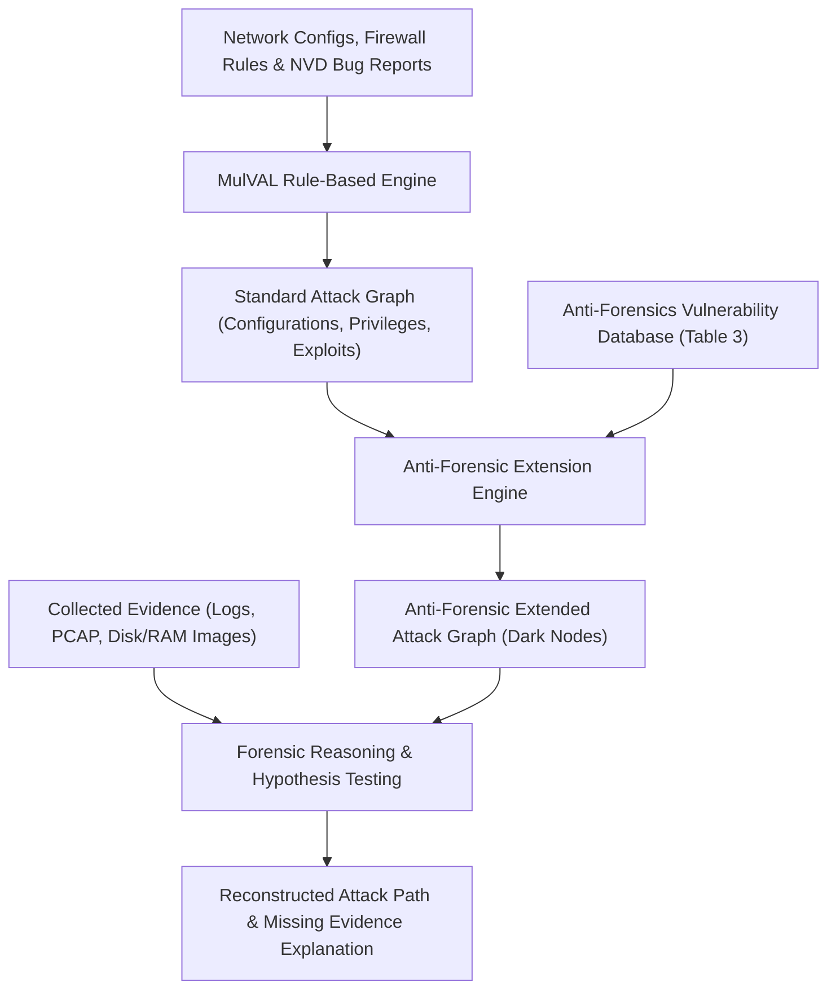
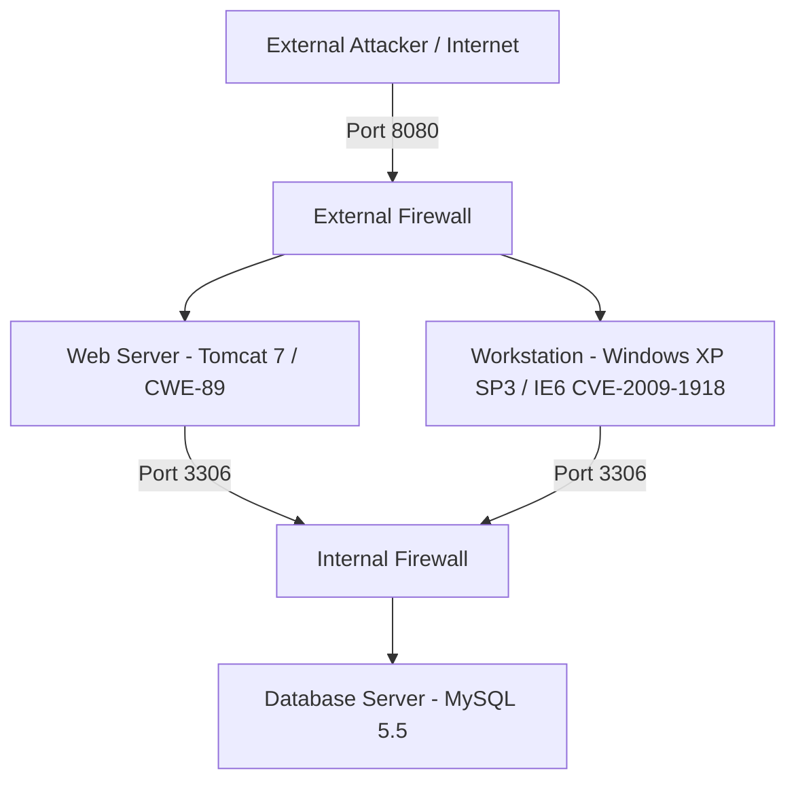

# Paper Summary: Using Attack Graphs in Forensic Examinations

- **Title**: Using Attack Graphs in Forensic Examinations
- **Authors**: Changwei Liu, Anoop Singhal, Duminda Wijesekera
- **Affiliation(s)**: Department of Computer Science, George Mason University, Fairfax VA 22030; National Institute of Standards and Technology (NIST), Gaithersburg MD 20899, USA
- **Publication**: 7th International Conference on Availability, Reliability and Security (ARES), 2012 / IEEE

---

## 1. Executive Summary

Digital forensics uses scientifically validated methods to collect, validate, and preserve digital evidence derived from digital sources to reconstruct criminal cyber events. In post-incident investigations, forensic examiners attempt to identify the series of actions taken by an attacker. Given system configurations and known vulnerability repositories such as the National Vulnerability Database (NVD), attack graphs compute potential attack paths, enabling investigators to hypothesize how an enterprise network was compromised.

However, modern attackers increasingly employ **anti-forensic techniques and tools** to obfuscate, minimize, or erase digital footprints—such as wiping log files, manipulating slack space, injecting code into memory, or encrypting disk partitions. These anti-forensic actions leave critical gaps in evidence, breaking the causal chain during forensic reconstruction and making it difficult to link exploited vulnerabilities to observable digital evidence.

To solve this fundamental challenge, this paper proposes extending traditional attack graphs (generated via MulVAL) by incorporating **Anti-Forensics Activity Nodes** and constructing an **Anti-Forensic Technique/Tool Vulnerabilities Database**. When collected forensic evidence is missing or incomplete, the enhanced attack graph provides a two-level reasoning capability: explaining the missing evidence through longer attack paths that incorporate evidence-wiping privileges and anti-forensic tool execution.

The authors demonstrate this approach through an explicit database attack case study involving Tomcat web server exploits, Windows XP client compromise, MySQL query log disabling (`SET GLOBAL general_log='OFF'`), and file deletion. The paper advocates extending public vulnerability repositories like NVD to include anti-forensic capabilities alongside standard security vulnerabilities.

---

## 2. System / Model Architecture

The forensic analysis pipeline integrates network configuration scanning, vulnerability database lookup, MulVAL attack graph generation, anti-forensics node mapping, and evidence correlation:



### Pipeline Walkthrough
1. **Inputs & Attack Graph Generation**: Network topology, firewall rules, host configurations, and NVD vulnerability reports are fed into the MulVAL rule-based engine to generate a standard logical attack graph mapping all potential exploit paths.
2. **Anti-Forensic Node Augmentation**: For every privilege escalation vertex (diamond node) in the attack graph, the engine checks whether the gained privilege level (e.g., administrator/root) enables anti-forensic activities.
3. **Database Querying**: The framework queries the **Anti-Forensics Vulnerability Database** (Table 3) to retrieve specific anti-forensic tools, techniques, and required privilege levels matching the target OS platform (Windows/Linux).
4. **Enhanced Attack Graph Construction**: Anti-forensic activity nodes are appended as dark rectangular vertices along the exploit paths. These nodes represent potential cover-up actions without violating the underlying causality between attack states.
5. **Two-Level Forensic Reasoning**:
   - *Level 1*: Evaluates existing, un-tainted evidence against standard attack graph paths.
   - *Level 2*: If expected evidence is missing at an exploit step, the investigator queries anti-forensic nodes to determine which tool or command (e.g., `BCWipe`, `SET GLOBAL general_log='OFF'`) erased the evidence and whether the attacker escalated privileges elsewhere to perform the wipe.

---

## 3. Formal Definitions & Mathematical Model

### 3.1 Attack Graph Model (MulVAL Representation)

An attack graph $G = (V, E)$ is a directed graph where vertices $V$ represent system configurations, attacker privileges, or exploit steps, and directed edges $E$ represent logical dependencies:

$$V = V_{config} \cup V_{priv} \cup V_{exploit}$$

- **Configuration Vertices ($V_{config}$)**: Represented as square nodes ($n:1$). Defines network service info, firewall rules, and existing software vulnerabilities (e.g., `vulExists(webServer, 'CWE-89', httpd, remoteExploit, privEscalation)`).
- **Privilege Vertices ($V_{priv}$)**: Represented as diamond nodes ($n:0$). Defines host privileges gained by the attacker (e.g., `execCode(webServer, apache)`).
- **Exploit Rule Vertices ($V_{exploit}$)**: Represented as oval nodes ($n:0$). Represents logical derivation rules linking preconditions to postconditions (e.g., `RULE 2 (remote exploit of a server program)`).
- **Dependency Edge**: A directed edge $(u, v) \in E$ exists if postcondition of $u$ satisfies a precondition of $v$, such that:

$$\bigwedge_{u \in Pre(v)} post(u) \implies pre(v)$$

---

### 3.2 Anti-Forensic Node & Dependency Model

Let $AF$ be an Anti-Forensic Activity Node appended to a privilege vertex $v_{priv} \in V_{priv}$. The dependency function $Dep_{AF}$ maps an anti-forensic capability to the prevention of forensic discovery:

$$Dep_{AF} : V_{priv} \times \mathcal{T}_{AF} \rightarrow \mathcal{E}_{missing}$$

where $\mathcal{T}_{AF}$ is the set of anti-forensic tools/techniques, and $\mathcal{E}_{missing}$ is the set of missing forensic evidence data.

---

### 3.3 Anti-Forensics Database Schema Attributes

The Anti-Forensic Vulnerabilities Database is formalized as a relational table $\mathcal{DB}_{AF} \subseteq \text{ID} \times \text{Category} \times \text{Tool} \times \text{Technique} \times \text{Windows} \times \text{Linux} \times \text{Privilege} \times \text{Access} \times \text{Vulnerability} \times \text{Effect}$:

- **ID**: Primary key identifier (e.g., $A1, D1, D2, H1 \dots H5, M1 \dots M5, T1$).
- **Category**: Class of anti-forensic action ($\text{Destroy Data}, \text{Hide Data}, \text{Minimize Footprint}, \text{Trail Obfuscation}, \text{Attack Tool}$).
- **Tool / Technique**: Specific software tool or operational method (e.g., `BCWipe`, `Steghide`, `TrueCrypt`, `Metasploit Meterpreter`, `Syscall Proxying`).
- **Platform Domains**: Supported operating systems ($\text{Windows} \in \{\text{98 Above}, \text{2000 Above}, \text{XP Above}, \text{All}\}$, $\text{Linux} \in \{\text{All}, \text{No}\}$).
- **Required Privilege**: Level of access needed ($\text{User}, \text{Administrator}, \text{Root}$).
- **Access Type**: Network location from which anti-forensics is launched ($\text{Internet}, \text{Computer}, \text{Physical Computer}$).
- **Vulnerability / Rule**: Underlying software mechanism or rule bypassed (e.g., `SNORT Rule`, `MySQL 5.1+ set log off command`, `TrueCrypt bootloader`, `Buffer Overflow`).
- **Effect**: Impact on digital evidence ($\text{Delete data permanently}, \text{Set general log off}, \text{Hide data in slack space}, \text{No code on hard disk}$).

---

## 4. Core Methodology / Algorithm(s)

### 4.1 Anti-Forensic Extended Attack Graph Construction (Method 1)

- **Input**: Original MulVAL attack graph $G = (V,E)$, Anti-Forensic Database $\mathcal{DB}_{AF}$, target host platform & privilege mapping.
- **Output**: Extended Attack Graph $G_{AF} = (V \cup V_{AF}, E \cup E_{AF})$.
- **Step-by-Step Logic**:
  1. Generate original attack graph $G$ using network configuration and NVD bug reports via MulVAL rule engine.
  2. Identify all privilege diamond vertices $v_{priv} \in V_{priv}$ corresponding to compromised hosts.
  3. For each $v_{priv}$, query $\mathcal{DB}_{AF}$ matching host platform OS, available access vector, and privilege level.
  4. If privilege level is insufficient for a desired anti-forensic tool (e.g., standard user vs. root), search for alternate privilege-escalation paths in $G$ (e.g., tricking internal user via social engineering to gain local admin rights).
  5. Add anti-forensics activity nodes $v_{AF} \in V_{AF}$ attached to $v_{priv}$ via dashed dependency edges.
  6. **Complexity**: Graph construction complexity is $O(|V| + |\mathcal{DB}_{AF}|)$, maintaining the structural scalability of standard attack graphs.

---

### 4.2 Two-Level Forensic Evidence Reasoning (Method 2)

- **Input**: Extended attack graph $G_{AF}$, collected digital evidence $\mathcal{E}_{coll}$, expected evidence baseline database (Table 2).
- **Output**: Reconstructed attack scenario and identified anti-forensic techniques.
- **Step-by-Step Logic**:
  1. **Level 1 (Direct Evidence Matching)**: Compare collected evidence $\mathcal{E}_{coll}$ (e.g., web server logs, MySQL query logs, PCAP files) against expected evidence signatures in Table 2 for each path in $G_{AF}$.
  2. **Level 2 (Missing Evidence Deduction)**:
     a. If evidence expected along an exploit path is absent (e.g., no IE history on workstation), flag potential anti-forensic intervention.
     b. Query anti-forensic nodes $v_{AF}$ attached to the candidate attack path in $G_{AF}$.
     c. Match missing evidence characteristics against the `Effect` attribute of candidate tools in $\mathcal{DB}_{AF}$ (Table 3).
     d. Determine whether attacker executed command-line log disabling (`SET GLOBAL general_log='OFF';`), disk wiping (`BCWipe`), or memory-only payloads (`Meterpreter`).
  3. Reconstruct full attack sequence combining verified evidence and deduced anti-forensic cover-ups.

---

## 5. Case Study / Experimental Validation

### 5.1 Experimental Network Topology & Configuration

The experimental network models a enterprise database infrastructure:
- **External Firewall**: Controls access from Internet to enterprise web server on TCP port 8080.
- **Internal Firewall**: Controls access from web server and internal workstations to MySQL database server on TCP port 3306.
- **Web Server**: Running Tomcat 7 on port 8080, hosting an unsanitized Java servlet:
  ```java
  theResult = theStatement.executeQuery(
      "select * from profiles where name='Alice' AND password='" + passWord + "'"
  );
  ```
- **Victim Workstation**: Internal user Alice running Windows XP SP3 with Internet Explorer 6 (IE6), vulnerable to `CVE-2009-1918` (remote code execution).
- **Database Server**: MySQL 5.5 listening on TCP port 3306, containing profile tables.



---

### 5.2 MulVAL Attack Steps & Path Trace

The generated MulVAL attack graph contains **25 nodes** describing two primary attack avenues:

#### Table 1: Attack Steps in Experimental Attack Graph

| Node ID | Node Description / MulVAL Rule |
|---|---|
| **1** | `execCode(dbServer, user)` |
| **2** | `RULE 2 (remote exploit of a server program)` |
| **3** | `netAccess(dbServer, tcp, 3306)` |
| **4** | `RULE 5 (multi-hop access)` |
| **5** | `hacl(webServer, dbServer, tcp, 3306)` |
| **6** | `execCode(webServer, apache)` |
| **7** | `RULE 2 (remote exploit of a server program)` |
| **8** | `netAccess(webServer, tcp, 8080)` |
| **9** | `RULE 6 (direct network access)` |
| **10** | `hacl(internet, webServer, tcp, 8080)` |
| **11** | `attackerLocated(internet)` |
| **12** | `networkServiceInfo(webServer, httpd, tcp, 8080, apache)` |
| **13** | `vulExists(webServer, 'CWE-89', httpd, remoteExploit, privEscalation)` |
| **14** | `RULE 5 (multi-hop access)` |
| **15** | `hacl(workStation, dbServer, tcp, 3306)` |
| **16** | `execCode(workStation, user)` |
| **17** | `RULE 3 (remote exploit for a client program)` |
| **18** | `accessMaliciousInput(workStation, secretary, 'IE')` |
| **19** | `RULE 22 (Browsing a malicious website)` |
| **20** | `hacl(workStation, internet, httpProtocol, httpPort)` |
| **21** | `inCompetent(secretary)` |
| **22** | `hasAccount(secretary, workStation, user)` |
| **23** | `vulExists(workStation, 'CVE-2009-1918', 'IE', remoteClient, privEscalation)` |
| **24** | `networkServiceInfo(dbServer, mySQL, tcp, 3306, user)` |
| **25** | `vulExists(dbServer, 'SQLinjection', mySQL, remoteExploit, privEscalation)` |

---

### 5.3 Forensic Evidence & Anti-Forensics Database Tables

#### Table 2: Example SQL Injection Attack Vulnerability Forensic Analysis Table

| ID | Attack | Software | Forensic Tool | Data Source | Key Data / Evidence Signature |
|---|---|---|---|---|---|
| **SQL1** | SQL Injection | MySQL 5.1 above | - | General Query log | `'something' or '1'='1'` |
| **SQL2** | SQL injection | Microsoft SQL server | - | Query Log | `'something' or '1'='1'` |
| **SQL3** | SQL injection | Microsoft SQL server | WFTSQL/Hypnosis | Cache Memory | `'something' or '1'='1'` |
| **CVE-2009-1918-1** | CVE-2009-1918 | Windows/IE 6-8 CSS | Wireshark | pcap file | Suspicious link based on port 8080 |
| **CVE-2009-1918-2** | CVE-2009-1918 | Windows/IE 6-8 CSS | - | IE History | Suspicious link based on port 8080 |
| **CVE-2009-1918-3** | CVE-2009-1918 | Windows/IE 6-8 CSS | - | Local Setting Temp folder | VNC executable file |
| **CWE-89-1** | CWE-89 | Software with MySQL | - | Log file on Software server | IP address combined SQL log |

---

#### Table 3: The Anti-Forensic Technique/Tool Vulnerabilities Database

| ID | Category | Tool | Technique | Windows | Linux | Privilege | Access | Vulnerability | Effect |
|---|---|---|---|---|---|---|---|---|---|
| **A1** | Attack Tool | - | Obfuscate signature | All | All | User | Internet | SNORT Rule | Bypass being detected by rules |
| **D1** | Destroy Data | BCWipe | Delete file content | 98 Above | All | User | Computer | Disk sanitization | Delete data permanently |
| **D2** | Destroy Data | - | Remove log file | All | All | User | Internet | MySQL 5.1+ set log off command | Set general log off (`SET GLOBAL general_log='OFF';`) |
| **H1** | Hide Data | Steghide | Steganography | All | All | User | Computer | Image/Audio embedding | Hide data to image or audio file |
| **H2** | Hide Data | Slacker.exe | Slack space hiding | 2000 Above | No | User | Computer | NTFS slack space | Hide data in slack space |
| **H3** | Hide Data | TrueCrypt | Encryption | XP Above | All | User | Computer | Passphrase encryption | Encrypt disk or partition and hide |
| **H4** | Hide Data | Rootkit | Hide data in memory | All | - | User | Internet | Memory injection | Bypass live incident response |
| **H5** | Hide Data | Evil Maid | Encryption passphrase | All | All | User | Physical Computer | TrueCrypt bootloader | Capture the key |
| **M1** | Minimize footprint | ShellCode | Memory injection | All | All | User | Internet | Buffer Overflow | No code in hard disk |
| **M2** | Minimize footprint | Reverse Shellcode | Syscall Proxying | All | All | User | Internet | Buffer Overflow | Attack without code |
| **M3** | Minimize footprint | Metasploit meterpreter | Memory injection | All | All | User | Internet | Metasploit exploit | Hack the victim machine |
| **M4** | Minimize footprint | random js toolkit | Change URL | All | All | User | Internet | Browser vulnerability | Infect webpages |
| **M5** | Minimize footprint | A4Proxy | Hide IP | All | All | User | Computer | Proxy chaining | Hide ID when surfing on internet |
| **T1** | Trail Obfuscation | - | Obfuscate payload | All | All | User | Internet | SNORT Rule | Obfuscate payload to bypass SNORT |

---

### 5.4 Attack Walkthrough & Anti-Forensics Analysis

1. **Observed MySQL Log**: General query log captures malicious entry:
   `120315 11:44:46 51 Query select * from profiles where name='Alice' and (password='alice' or '1' = '1')`
2. **Missing Workstation Evidence**: No traces (IE history, temp files) found on Alice's workstation (`192.168.0.x`).
3. **Web Server Log Correlation**: Tomcat web server log captures entry matching timestamp:
   `129.174.92.32 -- [15/Mar/2012:11:44:46-0400] POST /lab/Test HTTP/1.1 200 670`
4. **Deduction via Anti-Forensics Nodes**:
   - **Path 1 (Web Exploit)**: Internet $\rightarrow$ Tomcat Port 8080 (`CWE-89`) $\rightarrow$ MySQL Port 3306. Attacker executed SQL injection directly via HTTP POST.
   - **Path 2 (Workstation Social Engineering + Anti-Forensics)**: Internet $\rightarrow$ Malicious URL $\rightarrow$ Workstation IE6 (`CVE-2009-1918`) $\rightarrow$ TightVNC / Shell $\rightarrow$ Privilege Escalation $\rightarrow$ Execute Anti-Forensic Node `D1` (delete IE history / temp files) or `D2` (`SET GLOBAL general_log='OFF';`).
   - Comparison with Table 3 confirms that missing workstation evidence is explained by anti-forensic nodes `D1` / `M4` added along the workstation exploit diamond.

---

## 6. Limitations & Threats to Validity

1. **Manual Repository Population**: The Anti-Forensics Vulnerability Database requires ongoing manual curation of anti-forensic tools and techniques, as standard NVD reports do not currently catalog evidence-erasing capabilities.
2. **Coarse-Grained Privilege Matching**: Privilege requirements are categorized into general tiers (User, Admin, Root). Sub-granular operating system permissions (e.g., specific Windows privileges or Linux capabilities) are not formally modeled.
3. **Static Rule Dependencies**: The mapping between anti-forensic node effects and missing evidence relies on expert-crafted heuristic rules, which may produce ambiguous candidate tools when multiple anti-forensic utilities produce identical log suppression effects.

---

## 7. Key Takeaways & Impact

- **First Integration of Anti-Forensics into Attack Graphs**: Establishes the novel concept of augmenting attack graphs with anti-forensics activity nodes to account for missing digital evidence.
- **Complexity-Preserving Extension**: Appending anti-forensics nodes to privilege diamond vertices retains the linear scalability of standard attack graph generation tools (MulVAL).
- **Two-Level Forensic Analysis**: Enables investigators to reconstruct both the primary exploit sequence and secondary evidence cover-up actions.
- **Advocacy for NVD Enhancement**: Recommends expanding public vulnerability databases (such as NIST NVD) to record anti-forensics tool capabilities alongside standard security vulnerabilities.

---

## 8. Relevance to Temporal Attack Graphs (TAGs)

- **Timestamp Correlation & Anti-Forensics**: Anti-forensic actions often target temporal log sequences (e.g., log deletion or timestamp zeroing). Extending anti-forensic nodes into **Temporal Attack Graphs (TAGs)** allows modeling temporal gaps where expected events are missing from time-series logs.
- **Privilege Escalation over Time**: In a temporal setting, anti-forensic activity nodes are bounded by time windows $t_{\text{compromise}} \le t_{\text{anti-forensics}} \le t_{\text{discovery}}$. Incorporating temporal bounds prevents invalid hypotheses where anti-forensic tools are executed before privileges are escalated.
- **Cross-Repository Synthesis**:
  - **VS. Zhang et al. (2015)**: While Zhang et al. focus on detecting and correcting *falsified timestamps* in evidence graphs, Liu et al. focus on explaining *completely missing evidence* by modeling anti-forensic wiping tools in attack graphs.
  - **VS. Wang & Daniels (2008)**: Wang & Daniels assume evidence streams are available for correlation; Liu et al. provide the necessary extension to handle cases where evidence streams have been scrubbed by attackers.
