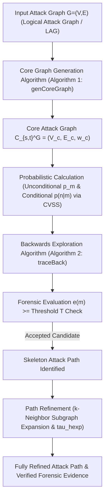

# Paper Summary: Tracking the Bad Guys: An Efficient Forensic Methodology To Trace Multi-step Attacks Using Core Attack Graphs

- **Title**: Tracking the Bad Guys: An Efficient Forensic Methodology To Trace Multi-step Attacks Using Core Attack Graphs
- **Authors**: Martín Barrère, Rodrigo Vieira Steiner, Rabih Mohsen, Emil C. Lupu
- **Affiliation(s)**: Department of Computing, Imperial College London, UK
- **Publication**: IEEE Conference on Communications and Network Security (CNS), 2017 (Crown copyright 2017, ISBN: 978-3-901882-98-2)

---

## 1. Executive Summary

As enterprise networks, Internet of Things (IoT) deployments, and Cyber-Physical Systems (CPS) expand rapidly in scale and connectivity, cyber security teams face an unprecedented surge in published vulnerabilities. When a security breach occurs, digital forensic investigators must quickly answer critical post-incident questions: how the attack occurred, which sequence of host privileges was exploited, and what route the intruder took from entry point to target. While **Logical Attack Graphs (LAGs)** provide a mathematical model of potential attack paths, standard LAGs suffer from severe state-space explosion as networks become larger and denser. In complex environments, a standard LAG contains thousands of redundant edges and shortcut paths, overwhelming forensic analysts and making real-time investigation computationally infeasible.

Existing network forensic methodologies often rely either on post-incident evidence correlation (such as evidence graphs) or on exhaustive search over standard attack graphs. However, evidence-based methods are strictly constrained by the availability and integrity of collected logs—which may be incomplete, unrecorded, or actively wiped by anti-forensic techniques. On the other hand, standard LAG-based backward tracing forces investigators to evaluate an excessive number of host nodes on a single flat topological plane, leading to network exploration rates exceeding 90%.

To resolve this challenge, this paper introduces the concept of **Core Attack Graphs (CAGs)**, a novel structural graph abstraction that dramatically reduces attack graph complexity while preserving all primary attack avenues between a source node $s$ and a target node $t$. CAGs achieve compactness by structurally summarizing alternative and redundant sub-paths between directly connected vulnerable nodes into induced paths, termed **Core Paths**. By conducting backward forensic investigations over the high-level core graph first, investigators trace the main structural backbone of an attack and recursively expand summarized subgraphs on demand.

The paper provides a rigorous mathematical formalization of core paths and core graphs, an $O(|V| + |E|)$ linear-time core graph generation algorithm, a probabilistic forensic investigation model incorporating investigator skill ($\lambda$) and confidence ($c_m$), a backward exploration algorithm (`traceBack`), and a path refinement mechanism ($k$). Empirical evaluations across pseudo-random cyclic graphs, DAGs, scale-free networks, and the benchmark P2P-Gnutella network (6,301 nodes, 20,777 edges) demonstrate that CAGs achieve the same accuracy as full LAGs (up to ~98.80%) while reducing the network surface exploration rate from ~91.87% down to **19.76% – 23.13%**.

---

## 2. System / Model Architecture

The core attack graph forensic methodology follows a multi-stage pipeline, from raw attack graph input to compressed core graph generation, probabilistic backwards exploration, forensic evaluation, and hierarchical path refinement:

### Pipeline Walkthrough
1. **Input Attack Graph Ingestion**: The system takes a directed attack graph $G = (V, E)$ (such as a logical attack graph generated via vulnerability scanners and network topology analysis), a designated attacker source node $s \in V$, and a target compromised node $t \in V$.
2. **Core Graph Generation (`genCoreGraph`)**: Algorithm 1 executes a recursive depth-first/breadth-first search over $G$, stripping out topological shortcuts and building the compressed Core Attack Graph $C_{s,t}^G = (V_c, E_c, \omega_c)$. Edges $e \in E_c$ act as summary links encoding alternative sub-paths via mapping function $\omega_c$.
3. **Probabilistic Scoring**: Utilizing Common Vulnerability Scoring System (CVSS) base metrics, the framework calculates conditional transition probabilities $p(n \mid m)$ across graph edges and unconditional reachability probabilities $p_m$ from source $s$ using Bayesian Networks (for DAGs) or Monte Carlo simulation (for cyclic graphs).
4. **Backward Forensic Tracing (`traceBack`)**: When node $n$ is flagged as compromised, Algorithm 2 constructs the back perimeter $FP_{back}(n)$ by ordering incoming neighbors $m$ according to descending traversal likelihood $p_m \cdot p(n \mid m)$.
5. **Individual Forensic Evaluation ($e(m)$)**: The forensic investigator (or automated forensic tool) evaluates candidate node $m$, returning boolean compromise status $r_m$ and confidence $c_m$. Factoring in investigator skill $\lambda$ yields trust level $t_m^\lambda = \lambda \cdot c_m$ and overall evaluation score $e(m)$. Nodes meeting threshold condition $e(m) \ge T$ are added to the attack path, and tracing recurses toward source $s$.
6. **Path Refinement & Hierarchical Expansion ($\tau_{hexp}$)**: To verify whether the attacker exploited a direct link or an inflated sub-path, $k$-neighbor refinement inspects local alternative routes, while expansion operator $\tau_{hexp}$ unfolds summarized core edges on demand.

---

## 3. Formal Definitions & Mathematical Model

### 3.1 Core Path & Core Attack Graph Model

#### Definition 1 (Core Path)
Given a directed graph $G = (V, E)$, a path $p(v_0, v_1, \dots, v_n)$ in $G$ ($n > 0$) is a **Core Path** if and only if no shortcut edge exists between any two non-adjacent nodes in $p$:

$$\forall v_i \in p, \quad \forall k \in [2, n - i], \quad (v_i, v_{i+k}) \notin E$$

- **Inflated Path**: A path containing at least two non-adjacent nodes that are directly connected in $G$. It is denoted as $p' \preceq p$, indicating that path $p$ is an inflated homeomorph of core path $p'$.
- **Core Edge Summary**: An edge $(v_i, v_{i+1}) \in p$ in a core path structurally reflects that $v_i$ can reach $v_{i+1}$ directly and also summarizes all alternative paths between $v_i$ and $v_{i+1}$ over $G$.

#### Definition 2 (Core Attack Graph)
Given a digraph $G = (V, E) \in \mathcal{G}$, a source node $s \in V$, and a target node $t \in V$, the corresponding **Core Attack Graph** $C_{s,t}^G = (V_c \subseteq V, E_c \subseteq E, \omega_c)$ is the result of a transformation $\tau_{cg}(G, s, t)$ defined as the union of core paths from $s$ to $t$ in $G$:

$$\tau_{cg}(G, s, t) \equiv C_{s,t}^G \equiv \bigcup_{p \in P_{s,t}^G} \{ p' \mid p' \in P_{s,t}^G, p' \preceq p \}$$

where $P_{s,t}^G$ is the set of all paths from node $s$ to node $t$ in $G$, and $\omega_c : E_c \rightarrow \mathcal{G}$ is a mapping function that, given an edge $(v_i, v_j) \in E_c$, returns a subgraph $H \subseteq G$ encoding the set of all possible paths $\{p_1, \dots, p_k\}$ from $v_i$ to $v_j$ in $G$.

#### Definition 3 (Hierarchical Core Graph Expansion $\tau_{hexp}$)
Given a core graph $C_{s,t}^G = (V_c, E_c, \omega_c)$, its complete expansion to the next level in the core edge hierarchy is controlled by transformation $\tau_{hexp} : \mathcal{C} \rightarrow \mathcal{C}$ defined as:

$$\tau_{hexp}(C_{s,t}^G) = C_{s,t}^G \cup \left( \bigcup_{e=(u,v) \in E_c} \{\tau_{cg}(\omega_c(e) - e, u, v)\} \right)$$

Let $C_{s,t}^{G, \delta}$ denote the graph obtained after expanding the original core graph $\delta$ times:
- $C_{s,t}^{G, 0} = C_{s,t}^G$ ($\delta = 0$ indicates no expansion).
- $C_{s,t}^{G, \delta} = \tau_{hexp}(C_{s,t}^{G, \delta-1})$.
- A full expansion ends when $C_{s,t}^{G, \delta} = LAG(G, s, t)$ for some $\delta \in \mathbb{N}$.

---

### 3.2 Forensic Model & Evaluation Function

#### Definition 4 (Forensic Evaluation $e(m)$)
Given an attack graph $G = (V, E)$, the forensic examination of a node $m \in V$ is modeled as a function:

$$F : V \rightarrow [0, 1] \times [0, 1]$$

which returns a tuple $F(m) = (r_m, c_m)$, where:
- $r_m \in \{0, 1\}$: Boolean compromise status of node $m$ ($0 \rightarrow \text{not compromised}, 1 \rightarrow \text{compromised}$).
- $c_m \in [0, 1]$: Real value representing the confidence level of the forensic investigator about result $r_m$.
- $\lambda \in [0, 1]$: Parameter capturing the skill level / expertise of the investigator.

The **Trust Level** of the result over node $m$ is defined as:

$$t_m^\lambda = \lambda \cdot c_m \in [0, 1]$$

Given a node $m \in V$, result $F(m) = (r_m, c_m)$, and trust level $t_m^\lambda$, the **Overall Forensic Evaluation** $e(m) \in [0, 1]$ is defined as:

$$e(m) = \begin{cases} \frac{1 - t_m^\lambda}{2}, & \text{if } r_m = 0 \\ \frac{1 + t_m^\lambda}{2}, & \text{if } r_m = 1 \end{cases}$$

- $e(m) = 0.5$: Complete uncertainty (investigator cannot confirm nor deny compromise).
- $e(m) \rightarrow 1$: High belief node $m$ is compromised.
- $e(m) \rightarrow 0$: High belief node $m$ is uncompromised.
- If $t_m^\lambda = 0$, $e(m) = 0.5$ regardless of whether $r_m$ is 0 or 1.

---

### 3.3 Probabilistic Graph Metrics & Search Functions

1. **Conditional Transition Probability $p(n \mid m)$**:
   Given edge $(m, n) \in E(G)$, $p(n \mid m)$ is computed from CVSS exploitability metrics of vulnerabilities present in node $n$ reachable from $m$.

2. **Unconditional Node Probability $p_m$**:
   Represents the probability of an attacker reaching node $m$ from source $s$. Computed via Bayesian Networks for acyclic graphs or Monte Carlo simulations for cyclic graphs.

3. **Back Forensic Perimeter $FP_{back}(n)$**:
   Given node $n$, incoming neighbors $M = \{m \mid (m, n) \in E\}$ are arranged in descending order of likelihood:

   $$FP_{back}(n) = [m_1, m_2, \dots], \quad m_i \in M, \quad \text{s.t. } p_{m_i} \cdot p(n \mid m_i) \ge p_{m_{i+1}} \cdot p(n \mid m_{i+1})$$

4. **Confidence Acceptance Candidate Function**:
   Given acceptance threshold $T \in [0.5, 1.0]$, candidate selection is defined as:

   $$candidate(m, T) = \begin{cases} 1, & \text{if } e(m) \ge T \\ 0, & \text{otherwise} \end{cases}$$

---

## 4. Core Methodology / Algorithm(s)

### Algorithm 1: `genCoreGraph` (Recursive Core Graph Generation)

- **Input**: Digraph $G(V,E)$, source node $s$, target node $t$, temporal path $p$, visited ancestor set $L$, core graph $C_{s,t}^G(V_c, E_c)$.
- **Result**: Complete Core Graph $C_{s,t}^G(V_c, E_c)$.
- **Complexity**: Time complexity is $O(|V| + |E|)$ worst-case linear in the size of original graph $G$. Space complexity is $O(|V|)$ to maintain visited set $L$ and recursion stack. Lower bound is $\Omega(1)$ when $t$ is directly adjacent to $s$.

#### Pseudocode Logic:
1. Append $s$ to temporary path $p$: $p \leftarrow p \oplus s$.
2. **If** $s \in V_c$ **then**:
   - Add path $p$ to core graph $C_{s,t}^G$ and return (node $s$ already visited).
3. **Else**:
   - Get outgoing nodes from $s$ in $G$: $N \leftarrow outgoingNodes(s, G)$.
   - **If** $t \in N$ **then**:
     - Append $t$ to path $p$: $p \leftarrow p \oplus t$.
     - Add path $p$ to core graph $C_{s,t}^G$.
   - **Else**:
     - Update reachable ancestor set: $L \leftarrow L \cup N \cup \{s\}$.
     - **Foreach** node $n \in N$ **do**:
       - **If** $n \notin L$ **then**:
         - Recursively call `genCoreGraph(G, n, t, p, L, C_{s,t}^G)`.

---

### Algorithm 2: `traceBack` (Recursive Backwards Attack Tracing)

- **Input**: Graph $G(V,E)$ (or $C_{s,n}^G$), source node $s$, current target node $n$, set `visited`, confidence threshold $T$, attack path $p$.
- **Result**: Attack path $p$ from $s$ to $n$.
- **Complexity**: Time complexity bounded by $O(|V_c| + |E_c|)$ over core graph.

#### Pseudocode Logic:
1. **If** $s == n$ **then**:
   - Append $s$ to path $p$: $p \leftarrow p \oplus s$.
   - Return `success` (source node reached).
2. **Else**:
   - Collect incoming core nodes: $L \leftarrow \{m \mid (m, n) \in E(G)\}$.
   - Prioritize $L$ by descending traversal likelihood as defined in $FP_{back}(n)$ (Equation 5).
   - **While** $m = next(L)$ **do**:
     - **If** $m \notin visited$ **then**:
       - Add $m$ to visited set: $visited \leftarrow visited \cup \{m\}$.
       - **If** $candidate(m, T)$ is True ($e(m) \ge T$) **then**:
         - Call `traceBack(G, s, m, visited, T, p)`.
         - **If** `success` **then**:
           - Append $n$ to path $p$: $p \leftarrow p \oplus n$.
           - Return `success`.

---

### Sub-Phase: Path Refinement Mechanism ($k$)

To prevent greediness in path selection and fairly compare LAGs with CAGs, a general refinement procedure is introduced:
1. Once a skeleton attack path is obtained via Algorithm 2, each link $(m, n)$ on the path is examined to determine whether the attacker exploited the direct core link or an inflated sub-path.
2. Parameter $k$ defines the number of additional neighbors of node $n$ that will be investigated.
3. The exploration procedure looks for potential routes between $m$ and $n$. If no route above threshold $T$ is found, the direct link $(m, n)$ is assumed.
4. Methods are denoted $LAG_{ki}$ or $CG_{ki}$, where $i \in \mathbb{N}$ specifies the number of additional neighbors investigated (e.g., $CG_{k0}, CG_{k1}$).

---

## 5. Case Study / Experimental Validation

### 5.1 Experimental Setup & Datasets
- **Generation Tool**: Implemented in **Naggen** network attack graph generator.
- **Topologies Evaluated**:
  1. *Pseudo-Random Cyclic Graphs*: Based on Erdős–Rényi (ER) model with edge creation probability $ec = 0.8$ (density 80%).
  2. *Directed Acyclic Graphs (DAGs)*.
  3. *Scale-Free Networks*: Based on Barabási–Albert (BA) model.
- **Base Parameters**: Input graph size $|V| = 30$ to $100$ nodes, forensic skill $\lambda = 1.0$, edge density $ec = 0.5 \text{ to } 0.8$, acceptance threshold $T = 0.51$, 50 iterations per setup (50 distinct input graphs).
- **Benchmark Real Dataset**: P2P-Gnutella network dataset (Stanford SNAP collection) containing **6,301 nodes** and **20,777 edges** ($s=0, t=6299$).

---

### 5.2 Quantitative Experimental Results

#### Table 1: Performance Comparison Across Topologies ($n=30, \lambda=1.0, T=0.51$, 50 Iterations)

| Network Topology | Graph Metric / Measurement | Input Graph | Logical AG ($LAG_{k0}$) | Logical AG ($LAG_{k1}$) | Core Graph ($CG_{k0}$) | Core Graph ($CG_{k1}$) |
|---|---|---|---|---|---|---|
| **Cyclic Graph** ($ec=0.8$) | Average Vertices $\|V\|$ | 30 | ~30 | ~30 | **~7** | **~7** |
| | Average Edges $\|E\|$ | 695 | 651 | 651 | **14** | **14** |
| | Compromised Nodes | 15% | - | - | - | - |
| | Population + / - | 15% / 85% | - | - | - | - |
| | Accuracy (%) | - | 100% | 100% | 92.27% | **98.80%** |
| | Precision (%) | - | 100% | 100% | 100% | **98.80%** |
| | **Exploration Rate (%)** | - | 91.87% (~27 nodes) | 91.87% (~27 nodes) | **23.13%** (~7 nodes) | **23.13%** (~7 nodes) |
| | True Positive Rate (TPR %) | - | 100% | 100% | 84.00% | **94.78%** |
| | False Positive Rate (FPR %) | - | 0.00% | 0.00% | 0.00% | **1.20%** |
| | FPR over Compromised Surface | - | 0.00% | 0.00% | 100% | **100%** |
| **Pseudo-Random DAG** | Average Vertices $\|V\|$ | 30 (102% baseline) | ~30 | ~30 | **~6** | **~6** |
| | Average Edges $\|E\|$ | 349 | 336 | 336 | **9** | **9** |
| | Population + / - | 11% / 89% | - | - | - | - |
| | **Exploration Rate (%)** | - | 76.43% | 76.43% | **19.76%** | **19.76%** |
| **Scale-Free Network** | Average Vertices $\|V\|$ | 30 | ~30 | ~30 | **~26** | **~26** |
| | Average Edges $\|E\|$ | 689 | 668 | 668 | **55** | **55** |
| | Population + / - | 16% / 84% | - | - | - | - |
| | **Exploration Rate (%)** | - | 71.60% ($LAG_{k0}$) | 98.53% ($LAG_{k1}$) | **27.60%** ($CG_{k1}$) | **27.60%** ($CG_{k1}$) |

---

#### Table 2: Scalability Analysis over Cyclic Input Graphs ($n=30 \text{ to } 100$)

| Graph Size ($n$) | Logical AG Vertices $\|V\|$ | Logical AG Edges $\|E\|$ | Core Graph Vertices $\|V_c\|$ | Core Graph Edges $\|E_c\|$ | Vertex Reduction (%) | Edge Reduction (%) |
|---|---|---|---|---|---|---|
| **$n = 30$** | ~30 | ~408 | **~18** | **~54** | **40.0% reduction** | **86.76% reduction** |
| **$n = 100$** | ~100 | ~4,853 | **~47** | **~397** | **53.0% reduction** | **91.81% reduction** |
| **P2P-Gnutella Benchmark** | 6,301 | 20,777 | **1,577** | **3,212** | **25.03% remaining** | **15.46% remaining** |

---

### 5.3 Comparison with Prior Work

- **Comparison with Standard Logical Attack Graphs (LAGs)**: Standard LAGs require examining almost the entire network surface during backward investigation (~91.87% of nodes in dense cyclic graphs, ~76.43% in DAGs, and ~98.53% in scale-free networks). Core Attack Graphs reduce the network exploration surface to **19.76% – 27.60%** while preserving near-identical accuracy (**98.80%** with $CG_{k1}$).
- **Comparison with Post-Incident Evidence Graphs (Wang & Daniels 2008)**: Evidence graphs rely on post-incident logs that are vulnerable to data deletion, missing sensors, or timestamp tampering (Zhang et al. 2015, Liu et al. 2012). CAGs work directly on topological attack vulnerability models, ensuring main attack avenues can be traced even when evidence is missing.

---

## 6. Limitations & Threats to Validity

1. **Dependence on Graph Density for Maximum Compression**: Core graph structural reduction relies on the presence of alternative/shortcut paths. In sparse trees or linear topologies with zero alternative paths, CAGs yield minimal node reduction, causing CAG size to approach LAG size.
2. **Sensitivity to Incorrect Low-Expertise Assessments**: If an investigator has low skill ($\lambda \ll 1$) or misclassifies a node ($r_m$ wrong) due to unobserved zero-day exploits, the backward search could follow a false perimeter unless the fallback mode triggers.
3. **Static CVSS Probability Assumption**: Edge traversal probabilities $p(n \mid m)$ rely on standardized CVSS scores, which capture generic vulnerability severity rather than attacker-specific operational preferences or zero-day likelihoods.

---

## 7. Key Takeaways & Impact

- **Core Path Structural Abstraction**: Defines core paths as induced paths (paths without shortcuts), offering a mathematically sound graph reduction technique for attack graphs.
- **Linear-Time Core Graph Generation**: Algorithm 1 computes core graphs in $O(|V| + |E|)$ time, avoiding exponential state-space explosion.
- **Drastic Reduction in Forensic Search Surface**: Reduces required network exploration rate from >90% down to **~19–25%** while retaining **98.80% accuracy**.
- **Hierarchical On-Demand Analysis**: Allows investigators to trace the high-level attack skeleton first and expand subgraphs via $\tau_{hexp}$ only when detailed evidence is required.

---

## 8. Relevance to Temporal Attack Graphs (TAGs)

- **Implicit vs. Explicit Temporal Dynamics**: Barrère et al. (2017) model attack paths structurally and probabilistically based on CVSS metrics, but do not explicitly incorporate temporal timestamps ($t_{\text{exploit}}$) or time-varying firewall rule updates into core paths.
- **Extension to Temporal Core Attack Graphs (T-CAGs)**: The core path concept (induced paths without shortcuts) can be naturally extended to a **Temporal Core Attack Graph (T-CAG)**. In a T-CAG, a path is a temporal core path if no *temporally valid* shortcut exists—i.e., shortcuts that satisfy strictly increasing time constraints ($t_1 < t_2 < \dots < t_k$).
- **Cross-Repository Synthesis**:
  - **VS. Wang & Daniels (2008)**: CAGs provide the missing structural backbone that prevents evidence graphs from getting lost in noisy, incomplete post-incident log streams.
  - **VS. Zhang et al. (2015)**: CAG core path causality bounds can be used as temporal validation constraints to verify whether evidence timestamps are topologically possible.
  - **VS. Liu et al. (2012)**: Summarized core links $\omega_c(e)$ can incorporate anti-forensic activity nodes to explain why intermediate steps within a core link left no observable digital footprint.
