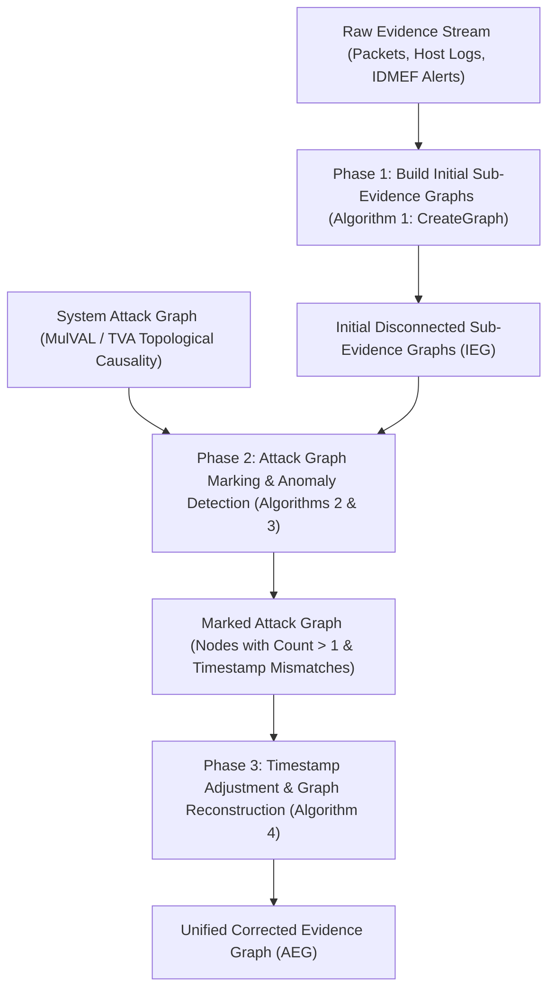
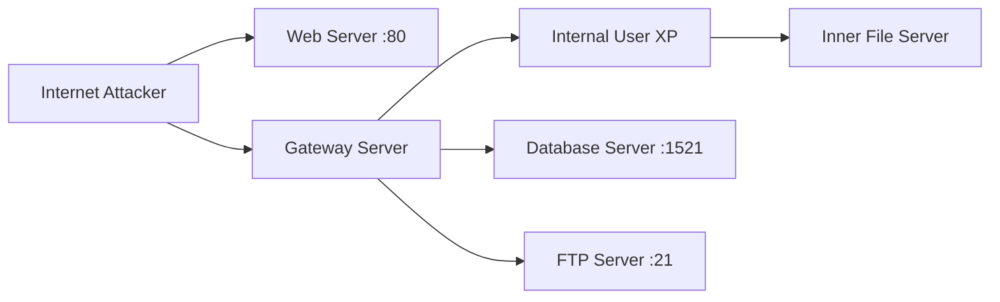

# Paper Summary: Detecting Falsified Timestamps in Evidence Graph via Attack Graph

- **Title**: Detecting falsified timestamps in evidence graph via attack graph
- **Authors**: Yuqiang Zhang, Jingsha He, Jing Xu
- **Affiliation(s)**: College of Computer Science, Beijing University of Technology, Beijing 100124, China; School of Software Engineering, Beijing University of Technology, Beijing, China
- **Publication**: 2015 8th International Symposium on Computational Intelligence and Design (ISCID), IEEE, Vol. 2, pp. 369–374 (DOI: 10.1109/ISCID.2015.111)

---

## 1. Executive Summary

Digital forensic analysis relies heavily on network and host log timestamps to establish chronological event sequences and reconstruct attack scenes. However, timestamps recorded in event logs are easily tampered with or falsified by attackers (an anti-forensic tactic) to obfuscate event ordering, mislead forensic investigators, or evade detection. When evidence graphs link intrusion evidence strictly based on corrupted timestamps, the resulting graph becomes fragmented into disconnected sub-evidence graphs or displays physically impossible causal sequences (e.g., an exploit being executed before its prerequisite backdoor is installed).

Existing evidence graph construction methods (such as Wang & Daniels 2008) assume that collected log timestamps are trustworthy. While alert correlation techniques attempt to filter noise, existing solutions fail to detect falsified timestamps or reconstruct the true event sequence when log timestamps have been maliciously altered.

To address this challenge, this paper introduces a novel 3-phase methodology that combines **Timestamp-based Evidence Graphs (IEG)** with system **Attack Graphs** to automatically detect, mark, and correct falsified timestamps. The core idea is to leverage the strict topological causality encoded within attack graphs (pre-conditions and post-conditions of exploits) to identify timestamp anomalies. When a host appears multiple times across disconnected sub-graphs or violates attack graph causality, the system marks the discrepancy, generates adjustment suggestions, and reconstructs a single, continuous, causality-consistent evidence graph.

The methodology is evaluated on a multi-stage network scenario involving web server exploits (`CVE-2014-5196`), Samba vulnerabilities (`CVE-2007-2447`), Windows client exploits (`MS10-08`), and internal file server attacks (`CVE-2014-3560`). Experiments demonstrate that the $O(n^2)$ algorithm successfully identifies altered timestamps (e.g., restoring an antedated log from 8:09 back to 8:15) and restores complete attack scenario continuity.

---

## 2. System / Model Architecture

The timestamp detection and evidence graph reconstruction framework operates in a three-stage modular pipeline:

### Pipeline Walkthrough
1. **Raw Data Ingestion & Normalization**: The system ingests an ordered stream of digital evidence collected from network packets, system logs, firewall logs, and IDS sensors. Each piece of evidence is formatted as a 6-tuple containing initial timestamps (`First-time`).
2. **Phase 1 — Initial Sub-Evidence Graph Construction (Algorithm 1)**: Evidence items are processed sequentially by timestamp. Matching events are linked into sub-graphs. If a timestamp discontinuity or missing link exists (caused by falsified timestamps), the process generates multiple disconnected sub-evidence graphs.
3. **Phase 2 — Attack Graph Marking & Detection (Algorithms 2 & 3)**:
   - Initial sub-evidence graphs are mapped onto vertices of the system **Attack Graph** (generated via MulVAL or TVA).
   - Algorithm 2 computes a reference count `count[N]` for each host node in the attack graph.
   - If a host node appears in multiple sub-graphs (`count[N] > 1`) or if edge timestamps violate attack graph topological causality, the timestamp is flagged as **falsified/tampered**.
   - Algorithm 3 calculates timestamp adjustment suggestions using width-first search (BFS) between source and victim nodes.
4. **Phase 3 — Evidence Graph Reconstruction (Algorithm 4)**: Uses the adjustment bounds calculated in Phase 2 to update the `Second-time` field of flagged evidence items (`SecondTime = max-src-time - 1`), reconnecting the disconnected sub-graphs into a unified, continuous evidence graph.

---

## 3. Formal Definitions & Mathematical Model

### 3.1 Evidence Tuple Model

#### Definition 1 (Evidence)
An evidence item in an attack scenario is defined as a sextuple (6-tuple):

$$E = (\text{ID}, \text{First-time}, \text{Second-time}, \text{SrcIP}, \text{DstIP}, \text{Classification})$$

where:
- $\text{ID}$: Unique index identifier for the evidence record.
- $\text{First-time}$: Initial timestamp recorded in the log file (potentially falsified by an attacker).
- $\text{Second-time}$: Adjusted timestamp computed after detection and correction ($0$ if unadjusted).
- $\text{SrcIP}$: Source IP address representing the initiator of the event.
- $\text{DstIP}$: Destination IP address representing the target host.
- $\text{Classification}$: Type of event or exploit (e.g., SSH login, HTTP GET, Samba exploit, HTTP tunnel).

---

### 3.2 Timestamp-Based Evidence Graph Model

#### Definition 2 (Evidence Graph)
An evidence graph $EG$ is defined as a sextuple (6-tuple):

$$EG = (N, E_i, L_n, L_e, T_i, T_a)$$

where:
- $N$: Set of nodes representing host-level entities involved in the evidence.
- $E_i$: Set of directed edges representing preprocessed evidence items connecting hosts.
- $L_n$: Set of labels indicating host attributes (e.g., host identity, IP address, role).
- $L_e$: Set of labels indicating edge attributes (e.g., classification, initial timestamp, adjusted timestamp).
- $T_i$: Initial timestamp series of evidences ($T_i = \{\text{First-time}(e) \mid e \in E_i\}$).
- $T_a$: Adjusted timestamp series of evidences ($T_a = \{\text{Second-time}(e) \mid e \in E_i\}$).

If an evidence record does not have a `Second-time` value set, `First-time` is used as its effective timestamp.

---

## 4. Core Methodology / Algorithm(s)

### Algorithm 1: `CreateGraph(G, E)` (Initial Evidence Graph Construction)

- **Input**: Evidence stream $E$ sorted in initial time order, current Evidence Graph $G(V, E_i)$.
- **Output**: Initial evidence graph / sub-evidence graphs $IEG$.
- **Step-by-Step Logic**:
  1. **Foreach** evidence $E$ in stream **do**:
     - Check if source host $N_{src}$ and destination host $N_{dst}$ exist in $G$.
     - If not, invoke `CreateNode(G, N)`.
     - Create directed edge `CreateEdge(G, E)` between $N_{src}$ and $N_{dst}$.
     - **Foreach** host $N \in \{N_{src}, N_{dst}\}$ in $G$ **do**:
       - **If** $E.FirstTime < E.FirstTime(N_{prev})$ in $G$ **then**:
         - Mark $e\text{-matched} \leftarrow \text{false}$.
         - Execute `RemoveEdge(G, E)`.
         - Create a new disconnected sub-evidence graph `CreateGraph(G, E)`.

---

### Algorithm 2: `MarkAttackGraph` (Initial Sub-Evidence Graph Marking)

- **Input**: Initial sub-evidence graphs $IEG$, system attack graph $A$.
- **Output**: Marked attack graph $A_{marked}$.
- **Step-by-Step Logic**:
  1. Initialize node reference count: $\text{count}[N] \leftarrow 0$ for all $N \in V(A)$.
  2. **Foreach** sub-graph $G \in IEG$ **do**:
     - **Foreach** edge $u \in V(EG)$ **do**:
       - Search for corresponding node in attack graph $V(A)$.
       - Set $\text{node-exist-count} \leftarrow 0$.
       - **Foreach** host $d \in V(A)$ affected by $u$ **do**:
         - **If** $N.id == d.id$ **then**:
           - Increment $\text{node-exist-count} \mathrel{+}= 1$.
           - Increment $\text{count}[N] \mathrel{+}= 1$.
       - **If** $\text{node-exist-count} > 0$ **then**:
         - Update graph attributes `UpdateGraph(A, u)`.
       - **Else**:
         - Remove invalid node `RemoveNode(A, u)`.

---

### Algorithm 3: `AdjustSuggestion` (Adjusting Falsified Timestamps)

- **Input**: Marked attack graph $A$, victim host node $N_{victim}$, edge $u$, edge $v$.
- **Output**: Set of edges with proposed `SecondTime` values.
- **Step-by-Step Logic**:
  1. Initialize queues $Q_n \leftarrow \emptyset$, $Q \leftarrow \emptyset$, $Q_s \leftarrow \emptyset$, $Q_d \leftarrow \emptyset$.
  2. Enqueue victim node: `ENQUEUE(Q, Adj[Nvictim])`.
  3. **While** $Q \neq \emptyset$ **do**:
     - Dequeue node $N \leftarrow \text{DEQUEUE}(Q)$.
     - **If** $\text{count}[N] > 1$ **then**:
       - **Foreach** incoming edge $u \in Adj[N]$ **do**:
         - If $u.src == N$, add $u$ to $Q_s$.
         - If $u.dst == N$, add $u$ to $Q_d$.
       - Compute temporal bounds:
         
         $$\text{max-src-time} = \max(Q_s)$$
         
         $$\text{min-dst-time} = \min(Q_d)$$

       - **If** $\text{min-dst-time} > \text{max-src-time}$ **then**:
         - **Foreach** edge $v \in Q_d$ **do**:
           - **If** $v.FirstTime == \text{min-dst-time}$ **then**:
             
             $$\text{SecondTime} = \text{max-src-time} - 1$$

---

### Algorithm 4: `ReconstructEvidenceGraph` (Adjusted Evidence Graph Reconstruction)

- **Input**: Stream of evidence in adjusted time order, initial evidence graph $G$.
- **Output**: Reconstructed adjusted sub-evidence graphs $AEG$.
- **Step-by-Step Logic**:
  1. **Foreach** evidence $E$ in stream **do**:
     - Set $matched \leftarrow \text{false}$.
     - **Foreach** graph $G \in AEG$ **do**:
       - **If** `Match(G, E)` is True **then**:
         - Set $matched \leftarrow \text{true}$; break.
     - **If** $matched == \text{false}$ **then**:
       - Create new evidence graph `CreateGraph(G, E)`.
     - Update timestamps across edges:
       - If $E.\text{SecondTime} \neq 0$, set $E.e\text{-time} = E.\text{SecondTime}$.
       - Else, set $E.e\text{-time} = E.\text{FirstTime}$.
     - Verify chronological causality:
       - **If** $e\text{-time} < E.\text{Time}$ **then**:
         - Set $e\text{-matched} \leftarrow \text{true}$.
       - **Else**:
         - `RemoveEdge(G, E)`, re-evaluate single nodes, and reconstruct graph.
- **Overall Complexity**: Bounded by $O(n^2)$, where $n$ is the total number of evidence records in the candidate pool.

---

## 5. Case Study / Experimental Validation

### 5.1 Test Network Topology & Host Vulnerabilities

The experimental setup consists of a multi-tiered enterprise network attacked from the Internet:

#### Table 1: Host IP Address and Vulnerability Configuration

| Host Role | IP Address | OS & Service Configuration | Vulnerability (CVE / MS) |
|---|---|---|---|
| **Gateway Server** | `159.226.95.65` / `192.168.0.1/24` | Ubuntu 8.04 / Samba 8.04 | `CVE-2007-2447`, `CVE-2009-4484` |
| **Web Server** | `159.226.95.66:80` | Ubuntu 10.04 | `CVE-2014-5196` |
| **Database Server** | `159.226.95.66:1521` / `192.168.0.14/24` | Windows Server 2003 | `CVE-2003-0252` |
| **FTP Server** | `159.226.95.66:21` | Windows Server 2003 | `MS03-026`, `CVE-2009-1979` |
| **Internal User** | `192.168.0.13/24` / `192.168.0.14/24` | Windows XP | `MS10-08` |
| **Internal File Server** | `192.168.0.12/24` | Ubuntu 10.04 | `CVE-2014-3560` |

---

### 5.2 Initial Evidence Records & Anti-Forensic Tampering

The collected evidence stream consists of 6 core records:

#### Table 2: Initial Evidence Records

| Evidence ID | Initial Timestamp (`First-time`) | Source IP (`SrcIP`) | Destination IP (`DstIP`) | Service / Exploit Classification |
|---|---|---|---|---|
| **Evidence 1** | `8:00` | `10.194.102.4` | `159.226.95.66` | HTTP (`CVE-2014-5196`) |
| **Evidence 2** | `8:10` | `192.168.0.1` | `192.168.0.13` | Samba (`CVE-2007-2447`) |
| **Evidence 3** | **`8:09` (Altered from `8:15`)** | `159.226.95.66` | `159.226.95.65` | HTTP (`CVE-2014-5196`) |
| **Evidence 4** | `8:20` | `192.168.0.13` | `192.168.0.12` | HTTP (`MS10-08`) |
| **Evidence 5** | `8:25` | `192.168.0.12` | `192.168.0.13` | FTP (`CVE-2014-3560`) |
| **Evidence 6** | `8:30` | `192.168.0.13` | `10.194.102.5` | HTTP Tunnel |

---

### 5.3 Step-by-Step Detection & Reconstruction Walkthrough

1. **Phase 1 Failure**: Because the attacker altered Evidence 3 timestamp from `8:15` to `8:09`, chronological processing places Evidence 3 (`8:09`) *before* Evidence 2 (`8:10`). Algorithm 1 cannot link Evidence 3 to the existing chain, splitting the evidence graph into **two disconnected sub-graphs** (Sub-graph 1: Evidence 1 & 3; Sub-graph 2: Evidence 2, 4, 5, 6).
2. **Phase 2 Marking**: Algorithm 2 maps both sub-graphs onto the system attack graph. `Gateway Server` (`159.226.95.65`) receives reference count `count = 2` (appearing in both sub-graphs). Algorithm 3 identifies a temporal impossibility: Evidence 3 (`8:09`) attempts to exploit Gateway Server *before* Web Server compromise was fully established.
3. **Timestamp Adjustment**: Algorithm 3 evaluates incoming/outgoing temporal bounds:
   - $\text{max-src-time} = 8:16$ (Web Server outbound activity).
   - $\text{min-dst-time} = 8:09$ (Falsified timestamp on Gateway Server).
   - Since $\text{min-dst-time} < \text{max-src-time}$, Algorithm 3 calculates adjusted timestamp:
     
     $$\text{SecondTime} = \text{max-src-time} - 1 = 8:15$$

4. **Phase 3 Reconstruction**: Algorithm 4 re-sorts the evidence stream using `SecondTime` ($8:15$). The two sub-graphs merge seamlessly into a single, continuous attack path:
   $$\text{Internet Attacker } (10.194.102.4) \xrightarrow{8:00} \text{Web Server } (159.226.95.66) \xrightarrow{8:15} \text{Gateway } (159.226.95.65) \xrightarrow{8:20} \text{Internal User } (192.168.0.13) \xrightarrow{8:25} \text{File Server } (192.168.0.12) \xrightarrow{8:30} \text{Exfiltration } (10.194.102.5)$$

---

## 6. Limitations & Threats to Validity

1. **Dependency on Accurate System Attack Graphs**: Timestamp detection relies entirely on the correctness of the pre-generated attack graph. If an attacker uses an unmodeled zero-day exploit, the attack graph will lack the corresponding topological node, leading to missed detection.
2. **Coarse Timestamp Adjustment Heuristic**: Algorithm 3 sets `SecondTime = max-src-time - 1`. While this restores causal ordering, it is a heuristic approximation that may not reflect the exact physical wall-clock time of the original event.
3. **Performance Scaling with Large Evidence Pools**: While $O(n^2)$ complexity is efficient for moderate candidate pools, real-time enterprise networks generating millions of raw log entries require front-end alert aggregation before applying Algorithm 1.

---

## 7. Key Takeaways & Impact

- **First Graph-Causality Timestamp Repair Framework**: Demonstrates that system attack graph causality can validate and repair tampered digital evidence log timestamps.
- **6-Tuple Evidence Representation**: Formally incorporates `Second-time` into evidence tuples to separate raw log timestamps from post-investigation verified timestamps.
- **Polynomial Runtime Efficiency**: Bounded by $O(n^2)$ time complexity, enabling practical deployment in incident response toolkits.
- **Automated Reconstruction of Disconnected Evidence**: Reconnects fragmented sub-graphs created by anti-forensic antedating or postdating attacks.

---

## 8. Relevance to Temporal Attack Graphs (TAGs)

- **Core Temporal Reasoning**: This paper is fundamentally a **Temporal Attack Graph** paper—it explicitly models time sequences ($T_i, T_a$) and enforces temporal monotonicity across attack state transitions ($t_{precondition} < t_{exploit} < t_{postcondition}$).
- **Temporal Consistency Constraints**: Provides mathematical mechanics for validating temporal consistency in TAGs: if $e_1 \rightarrow e_2$ is a required edge in a TAG, then $t(e_1) < t(e_2)$ MUST hold; violations directly pinpoint anti-forensic clock tampering.
- **Cross-Repository Synthesis**:
  - **VS. Wang & Daniels (2008)**: Wang & Daniels assume log timestamps are accurate. Zhang et al. provide the necessary pre-processing repair mechanism when evidence timestamps have been falsified.
  - **VS. Liu et al. (2012)**: While Liu et al. address *missing* evidence via anti-forensics activity nodes, Zhang et al. address *tampered* evidence timestamps.
  - **VS. Barrère et al. (2017)**: Barrère et al.'s core path reduction can be integrated into Phase 2 of Zhang et al. to accelerate attack graph topological checks over large networks.
