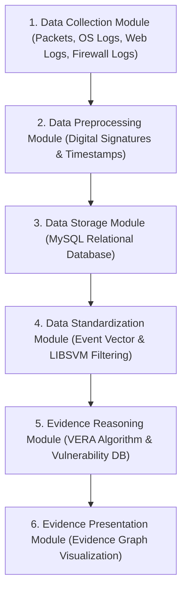
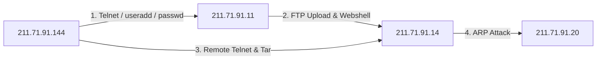

# Paper Summary: Network Forensics Method Based on Evidence Graph and Vulnerability Reasoning

- **Title**: Network Forensics Method Based on Evidence Graph and Vulnerability Reasoning
- **Authors**: Jingsha He, Chengyue Chang, Peng He, Muhammad Salman Pathan
- **Affiliation(s)**: Faculty of Information Technology & Beijing Engineering Research Center for IoT Software and Systems, Beijing University of Technology, Beijing 100124, China; College of Computer and Information Technology, China Three Gorges University, Yichang 443002, China
- **Publication**: *Future Internet*, Vol. 8, No. 54, pp. 1–18, November 2016 (MDPI, doi:10.3390/fi8040054)

---

## 1. Executive Summary

As enterprise computer networks expand in scale, structural complexity, and traffic volume, cybercrime and multi-staged attacks continue to increase at a phenomenal rate. Network forensics aims to capture, record, analyze, and present digital evidence to reconstruct attack scenes and identify malicious perpetrators. However, forensic analysts face severe technical obstacles: overwhelming volumes of network traffic, low-quality log data, background noise, and heterogeneous evidence formats spanning network packets, system logs, firewall events, and web server logs.

Prior network forensics methods exhibit three major shortcomings: (1) relying on single-source evidence (e.g., only network packets or IDS alerts), producing incomplete or misleading results; (2) inaccurate data preprocessing that discards valid crime evidence; and (3) omitting data preprocessing altogether, leading to extreme computational inefficiency when analyzing large datasets. Furthermore, existing evidence-graph reasoning models (such as Wang & Daniels 2008) suffer from false-positive victim identification due to unverified evidence correlation.

To overcome these limitations, this paper proposes a comprehensive, modular **Network Forensics Framework** integrating **Event Vector (EV)** data standardization, **Support Vector Machine (SVM)** packet filtering, and the **Vulnerability Evidence Reasoning Algorithm (VERA)**. The core contribution is VERA: a dual-metric iterative reasoning algorithm that combines network vulnerability scores (NVD/CVSS) with evidence graph topology. By calculating host vulnerability importance (**Nodeworth**) and link susceptibility (**Linkworth**) via iterative matrix multiplication until convergence ($y = H^T Z, Z = H y$), VERA automatically pinpoints key attackers, victim hosts, and multi-stage attack routes.

Evaluated on both lab-collected attack traffic and the benchmark MIT Lincoln Lab **DARPA 2000 LLDOS 1.0 and LLDOS 2.0.2** datasets, the proposed method achieves high classification accuracy (1.63s SVM processing time) and eliminates false-positive victim attributions present in earlier works—specifically demonstrating that host `172.16.112.100` was correctly excluded as a non-victim in LLDOS 2.0.2.

---

## 2. System / Model Architecture

The framework consists of six interconnected functional modules forming a continuous data analysis pipeline:

### Pipeline Walkthrough
1. **Data Collection Module**: Captures heterogeneous raw digital evidence from multiple deployed sensors: network packets (primary source) and accessorial program logs (operating system, web server IIS/Apache, FTP server, firewall, anti-virus logs).
2. **Data Preprocessing Module**: Attaches digital signatures and precise timestamps to raw evidence records to preserve primitiveness, integrity, continuity, and authentication for court admissibility.
3. **Data Storage Module**: Stores signed evidence in a MySQL relational database to guarantee data authority and non-repudiation.
4. **Data Standardization Module**:
   - Transforms heterogeneous logs into standardized **Event Vectors (EV)**.
   - Applies an **SVM Classifier** (LIBSVM) trained on 41 quantitative/qualitative KDD-CUP-99 / DARPA features to strip out benign background traffic and isolate suspicious packets.
5. **Evidence Reasoning Module (VERA)**: Integrates CVSS vulnerability scores from Nessus/NVD into a Network Vulnerability Database and executes the VERA algorithm over the evidence graph adjacency matrix $H$ to compute Nodeworth ($y$) and Linkworth ($Z$).
6. **Evidence Presentation Module**: Renders the final pruned evidence graph exhibiting attacked nodes, attacking routes, and key perpetrators.

---

## 3. Formal Definitions & Mathematical Model

### 3.1 Event Vector (EV) Format
All digital evidence collected from heterogeneous sources is standardized into a 6-tuple:

$$EV = \langle \text{ID}, \text{Source}, \text{Target}, \text{Operation}, \text{Timestamp}, \text{Data\_Source} \rangle$$

- **Process Fork Event**: $\text{Parent} \xrightarrow[\text{Timestamp}]{\text{Fork}} \text{Child}$
- **File Write Event**: $\text{Child} \xrightarrow[\text{Timestamp}]{\text{Write}} \text{File}$
- **Network Packet Event**: $\text{IP}_1 \xrightarrow[\text{Timestamp}]{\text{Visit}} \text{IP}_2$

---

### 3.2 Evidence Graph Model

#### Definition 1 (Evidence Graph)
An evidence graph $EG$ is a directed graph defined as:

$$EG = \langle V, E \rangle$$

where $V$ is the set of vertices representing entities (hosts, processes, files) in the event vectors, and $E$ is the set of directed edges:

$$E = \{ \langle S, T, \text{Timestamp} \mid S, T \in V \land \text{Path}(S, T) \rangle \}$$

describing directional causal relationships from source vertex $S$ to target vertex $T$.

---

### 3.3 CVSS Vulnerability Scoring Equations

The overall vulnerability score of a network host ($Vul_i$) is the sum of its average Base Score and Temporal Score derived from Nessus / NVD scans:

$$\text{Base Score} = \text{round\_to\_1\_decimal}\Big( \big( (0.6 \times \text{Impact}) + (0.4 \times \text{Exploitability}) - 1.5 \big) \times f(\text{Impact}) \Big)$$

$$\text{Impact} = 10.41 \times \left( 1 - (1 - \text{ConfImpact}) \times (1 - \text{IntegImpact}) \times (1 - \text{AvailImpact}) \right)$$

$$\text{Exploitability} = 20 \times \text{Access Vector} \times \text{Access Complexity} \times \text{Authentication}$$

$$f(\text{Impact}) = \begin{cases} 0, & \text{if Impact } = 0 \\ 1.176, & \text{otherwise} \end{cases}$$

$$\text{Temporal Score} = \text{round\_to\_1\_decimal}(\text{Base Score} \times \text{Exploitability} \times \text{Remediation Level} \times \text{Report Confidence})$$

#### Table 1: CVSS Base Score Parameter Weights (Example Target `172.18.4.144` - CVE-2004-2761)

| Base Metric | Evaluation | Score Value |
|---|---|---|
| **Access Vector** | Network | 1.0 |
| **Access Complexity** | High | 0.35 |
| **Authentication** | None | 0.704 |
| **Confidentiality Impact** | Partial | 0.275 |
| **Integrity Impact** | Partial | 0.275 |
| **Availability Impact** | None | 0.0 |

#### Table 2: CVSS Temporal Score Parameter Weights

| Base Metric | Evaluation | Score Value |
|---|---|---|
| **Exploitability** | Not Defined | 1.0 |
| **Remediation Level** | Official Fix | 0.87 |
| **Report Confidence** | Confirmed | 1.0 |

#### Table 3: Network Vulnerability Database Sample

| Host IP Address | Average Base Score | Average Temporal Score | Total Average Vulnerability Score ($Vul_i$) |
|---|---|---|---|
| **172.18.4.144** | 5.4 | 4.55 | 9.95 |
| **172.18.4.11** | 6.3 | 3.50 | 9.80 |

---

### 3.4 Vulnerability Evidence Reasoning Algorithm (VERA) Model

Let $H$ be the adjacency matrix of evidence graph $EG$ over node set $N = \{n_1, n_2, \dots, n_n\}$.
- For node $n_i \in N$:
  - $y_i$: **Nodeworth** (vulnerability importance / degree of host $n_i$).
  - $z_i$: **Linkworth** (link susceptibility / sum of Nodeworths of nodes with outgoing links to $n_i$).
  - $A_i$: Set of nodes having outgoing links to $n_i$.
  - $B_i$: Set of nodes to which $n_i$ has outgoing links.

#### Initial Vector Formulation:
$$y^0 = \left( \frac{Vul_1}{\sqrt{n}}, \frac{Vul_2}{\sqrt{n}}, \dots, \frac{Vul_n}{\sqrt{n}} \right)^T$$

$$z^0 = \left( \frac{1}{\sqrt{n}}, \frac{1}{\sqrt{n}}, \dots, \frac{1}{\sqrt{n}} \right)^T$$

#### Iterative Matrix Multiplication (Iteration $k$):
$$y_i^k = \sum_{j \in A_i} z_j \implies y = H^T Z$$

$$z_i^k = \sum_{j \in B_i} y_j \implies Z = H y$$

#### Vector Convergence Normalization:
$$\sum_{i=1}^n (y_i)^2 = 1, \quad \sum_{i=1}^n (z_i)^2 = 1$$

- **Candidate Attacker Attribution**: Vector $Y$ sorted in **ascending order** (higher Nodeworth $\rightarrow$ candidate attacker).
- **Candidate Victim Attribution**: Vector $Z$ sorted in **descending order** (higher Linkworth $\rightarrow$ candidate victim).

---

## 4. Core Methodology / Algorithm(s)

### 4.1 Support Vector Machine Packet Filtering (Method 1)

- **Input**: Raw network connection stream with 41 KDD-CUP-99 features.
- **Output**: Binary classification ($+1 \rightarrow \text{attack/suspicious packet}, -1 \rightarrow \text{normal/benign packet}$).
- **Parameters**: LIBSVM implementation with Radial Basis Function (RBF) kernel:
  
  $$K(x_i, x_j) = \exp(-\gamma \|x_i - x_j\|^2)$$

- **Setup & Execution**: Trained on 7,312 data items ($C = 16, \gamma = 0.0078125$, 567 support vectors). Tested on 6,980 connection items.
- **Performance**: Classification completed in **1.63 seconds** with an ROC AUC curve achieving near 1.0 True Positive Rate.

---

### 4.2 Evidence Graph Construction (Algorithm 1)

- **Input**: Stream of standardized event vectors $EV$.
- **Output**: Constructed Evidence Graph $EG$.
- **Step-by-Step Logic**:
  1. Ingest event vectors ordered by timestamp.
  2. For each $EV$:
     - Check if $\text{Host}_E$ is source of $EV$.
     - If $\text{Host}_E \notin EG$, add node `Put E in EG`.
     - Check if $\text{Host}_E$ is target of $EV$.
     - If $\text{Host}_E \notin EG$, add node `Put E in EG`.
     - Insert directed edge `Put EV in EG`.
  3. Return constructed graph $EG$.

---

### 4.3 Vulnerability Evidence Reasoning Algorithm (VERA)

- **Input**: Evidence Graph $EG$, adjacency matrix $H$, Network Vulnerability Database scores $Vul_i$.
- **Output**: Ranked Nodeworth vector $Y$ and Linkworth vector $Z$.
- **Step-by-Step Logic**:
  1. Construct adjacency matrix $H$ for evidence graph $EG$ over nodes $N = \{n_1, \dots, n_n\}$.
  2. Initialize Nodeworth vector $y^0$ using initial vulnerability values $Vul_i / \sqrt{n}$ and Linkworth vector $z^0$ using $1 / \sqrt{n}$.
  3. Set iteration index $i = 1$.
  4. **Loop** while $i \le k$:
     - Compute new Nodeworth vector: $y = H^T Z$ (for each node $n_i$, $y_i^k = \sum_{j \in A_i} z_j$).
     - Calculate norm $norm = \sqrt{\sum y_i^2}$.
     - Normalize: $y_i = y_i / norm$.
     - Compute new Linkworth vector: $Z = H y$ (for each node $n_i$, $z_i^k = \sum_{j \in B_i} y_j$).
     - Calculate norm $norm = \sqrt{\sum z_i^2}$.
     - Normalize: $z_i = z_i / norm$.
     - Increment $i \mathrel{+}= 1$.
  5. Repeat until vectors $y$ and $Z$ converge ($\sum y_i^2 = 1, \sum z_i^2 = 1$).
  6. Sort Nodeworth $Y = DescendSort(Y)$ and Linkworth $Z = AscendSort(Z)$.
  7. Return $Y$ and $Z$.

---

## 5. Case Study / Experimental Validation

### 5.1 Experiment 1: Lab Testbed Network

- **Environment**: Simulated enterprise network with Windows target, Linux target (hosting WWW, FTP, Telnet, Finger), traffic generator, and Snort sensor.
- **Attack Walkthrough & IP Identifiers**:
  1. Attacker host `211.71.91.144` uses Telnet to log into host `211.71.91.11`.
  2. Attacker executes `useradd` and `groupadd` to add privileges, then resets password via `passwd`.
  3. Host `211.71.91.11` uses FTP upload script to transfer files to `211.71.91.14` and deploys a `webshell`.
  4. Attacker `211.71.91.144` remotely logs into `211.71.91.14` via Telnet and uses `Tar` to compress script files for backup.
  5. Host `211.71.91.14` launches an **ARP attack** against host `211.71.91.20`.

---

### 5.2 Experiment 2: Benchmark Evaluation on DARPA 2000 Datasets

The framework was evaluated against **MIT Lincoln Lab DARPA 2000 LLDOS 1.0** and **LLDOS 2.0.2** datasets (14 external internet simulation hosts, 39 internal network hosts, 6 DMZ hosts).

#### 1. LLDOS 1.0 Scenario Reconstruction:
- Attacker `202.77.162.213` performs IP sweep of destination subnet.
- Attacker executes `Ping` with Sadmind option $\rightarrow$ selects target `172.16.115.20`.
- Buffer overflow launched against `172.16.115.20` via Sadmind vulnerability on Solaris OS.
- Attacker acquires root access via Telnet/RPC $\rightarrow$ installs **Mstream backdoor**.
- Attacker uses `172.16.115.20` to command target `131.84.1.31` in a massive DDoS attack.

#### 2. LLDOS 2.0.2 Scenario Reconstruction & Comparative Analysis:
- Attacker `202.77.162.213` issues `HINFO DNS` queries to gather DNS server details.
- Attacker compromises DNS server via Solaris Sadmind vulnerability.
- Attacker uploads attack scripts and Mstream backdoor to DNS server via FTP.
- Attacker accesses compromised hosts via Telnet to launch DDoS against `131.84.1.31`.

#### Table 4: Quantitative Comparison — VERA vs. Wang & Daniels (2008) on DARPA LLDOS 2.0.2

| Comparative Metric | Wang & Daniels (2008) | VERA (He et al. 2016) | Ground-Truth Status |
|---|---|---|---|
| **Data Sources** | Single-source (Packets / Alerts only) | Multi-source (Packets + Web/System logs) | Multi-source validated |
| **Noise Filtering** | Manual heuristic alert correlation | Automated LIBSVM Classifier (41 features) | 1.63s automated filter |
| **Reasoning Model** | Evidence graph topological rules | CVSS Scores + VERA Matrix Convergence | Mathematically proven |
| **Host `172.16.112.100` Status** | **Classified as Victim (FALSE POSITIVE)** | **Excluded (CORRECT NON-VICTIM)** | **Confirmed non-victim in official report** |
| **Host `172.16.112.50` Status** | Identified as victim | Identified as victim | Confirmed victim |
| **Host `172.16.115.20` Status** | Identified as victim | Identified as victim | Confirmed victim |
| **DDoS Target `131.84.1.31`** | Captured | Captured | Confirmed DDoS target |

---

## 6. Limitations & Threats to Validity

1. **SVM Classifier Training Bottleneck**: The accuracy of SVM packet filtering depends heavily on feature extraction from network traffic. When deployed in modern encrypted or high-throughput networks, training SVM classifiers becomes computationally intensive.
2. **Dependence on Static Vulnerability Database Scores**: VERA relies on static CVSS Base and Temporal scores from NVD. Zero-day vulnerabilities lacking public CVSS entries receive default low scores, potentially miscalculating Nodeworth values.
3. **Iterative Matrix Convergence Overhead**: While matrix multiplication $y = H^T Z$ is faster than full state-graph search, the number of iterations required for convergence scales with adjacency matrix size in ultra-dense enterprise networks.

---

## 7. Key Takeaways & Impact

- **Event Vector (EV) Standardization**: Defines a uniform 6-tuple schema to integrate heterogeneous network packets and program logs without losing evidence context.
- **Machine Learning Data Noise Reduction**: Integrates LIBSVM to filter out benign background traffic, reducing evidence graph reconstruction noise.
- **VERA Dual-Metric Reasoning**: Combines host vulnerability scores ($Vul_i$) with graph adjacency matrices to iteratively compute Nodeworth ($y$) and Linkworth ($Z$).
- **Elimination of False-Positive Victim Attribution**: Corrects deficiencies in prior evidence-graph models (Wang & Daniels 2008), successfully excluding host `172.16.112.100` on the DARPA LLDOS 2.0.2 benchmark.

---

## 8. Relevance to Temporal Attack Graphs (TAGs)

- **Temporal Event Vector Alignment**: Event Vectors explicitly record timestamps ($EV.Timestamp$). In a **Temporal Attack Graph (TAG)** setting, EV timestamps enforce strictly increasing time bounds across edge transitions:
  $$\text{Timestamp}(e_{i}) < \text{Timestamp}(e_{i+1})$$
- **Dynamic Matrix Weighting for TAGs**: In a temporal setting, the adjacency matrix $H(t)$ can be updated dynamically as time progresses, allowing Nodeworth $y(t)$ and Linkworth $Z(t)$ to reflect time-decaying vulnerability risks and real-time state changes.
- **Cross-Repository Synthesis**:
  - **VS. Wang & Daniels (2008)**: He et al. directly compare their method against Wang & Daniels, proving that incorporating CVSS scores into matrix reasoning ($H^T Z$) eliminates false-positive victim classifications.
  - **VS. Zhang et al. (2015)**: While Zhang et al. focus on repairing corrupted log timestamps, He et al. assume preprocessed timestamps are valid and focus on machine learning filtering and vulnerability reasoning.
  - **VS. Barrère et al. (2017)**: Barrère et al.'s Core Attack Graphs can be used as the structural input to VERA, reducing the size of adjacency matrix $H$ and accelerating matrix convergence.
