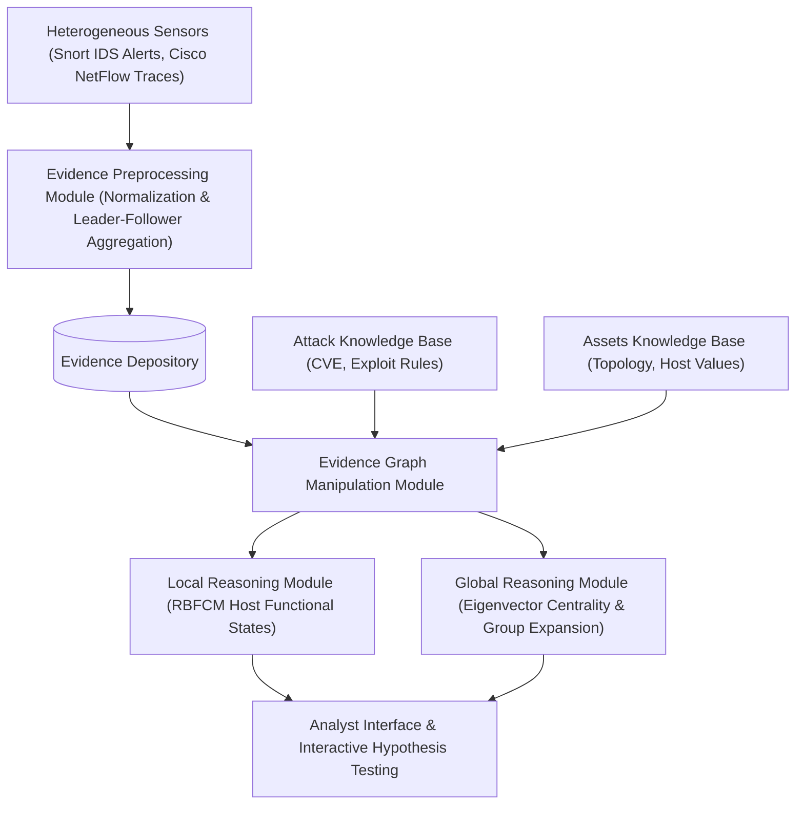

# Paper Summary: A Graph Based Approach Toward Network Forensics Analysis

- **Title**: A Graph Based Approach Toward Network Forensics Analysis
- **Authors**: Wei Wang, Thomas E. Daniels
- **Affiliation(s)**: Department of Electrical and Computer Engineering, Iowa State University, Ames, IA 50011, USA
- **Publication**: *ACM Transactions on Information and System Security* (TISSEC), Vol. 12, No. 1, Article 4, pp. 4:1–4:33, October 2008 (preliminary versions presented at ACSAC 2005 and DFRWS 2005)

---

## 1. Executive Summary

Digital forensic investigators face two fundamental technical challenges when analyzing post-incident cyber attacks: (1) handling massive volumes of low-quality, noisy intrusion evidence generated by security sensors (e.g., IDS false positives and NetFlow records), and (2) reconstructing complex, multi-staged cyber attacks that span multiple network subnets and evolving host roles. Traditional intrusion correlation tools focus on real-time detection rather than post-hoc investigation, leaving analysts overwhelmed by redundant log data and manual correlation tasks.

To solve these challenges, this seminal paper introduces a comprehensive **Graph-Based Network Forensics Analysis Framework** centered around a novel **Evidence Graph Model**. The framework normalizes heterogeneous security data into primary evidence (IDS alerts) and secondary evidence (NetFlow traces). It applies a **Leader-Follower Alert Aggregation** algorithm to merge duplicate alerts into HyperAlerts, achieving up to 99.7% alert volume reduction.

Central to the analysis mechanism is a two-level **Hierarchical Reasoning Framework**:
1. **Local Reasoning (Functional Analysis)**: Employs **Rule-Based Fuzzy Cognitive Maps (RBFCM)** to model causal transitions among host functional roles (*Attacker*, *Victim*, *Stepping Stone*, *Affiliated*).
2. **Global Reasoning (Structural Analysis)**: Uses **Eigenvector Centrality** ($Ax = \lambda x$) for structural seed selection, followed by distance-based single-linkage agglomerative clustering on an undirected correlation graph $\hat{G}$ to extract attack groups.

Furthermore, the paper provides an **Interactive Hypothesis Testing** mechanism using $\langle \text{Association}, \text{Classification}, \text{Time} \rangle$ triples to uncover non-explicit secondary evidence (such as out-of-band FTP exfiltration or warez server uploads). Evaluated on a 30-host testbed, the benchmark **DARPA 2000 LLDOS 2.0.2** dataset, and a large-scale ARDA military benchmark dataset, the framework demonstrates 100% attack scenario coverage and up to 83.3% reasoning accuracy.

---

## 2. System / Model Architecture

The forensic analysis architecture integrates sensor collection, data preprocessing, knowledge base lookups, evidence graph manipulation, and dual-level hierarchical reasoning:

### Pipeline Walkthrough
1. **Evidence Collection & Preprocessing**: Primary evidence (IDS alerts) and secondary evidence (NetFlow records) are collected from heterogeneous network sensors, normalized into unified records, and aggregated via the Leader-Follower algorithm into HyperAlerts.
2. **Knowledge Base Integration**: Host asset values (Asset KB) and exploit phase mappings (Attack KB) are retrieved to parameterize graph nodes and edges.
3. **Evidence Graph Manipulation**: Preprocessed HyperAlerts are instantiated as host-level nodes $N$ and directed evidence edges $E$. Analysts can perform graph edit operations (insert/delete node/edge, update state/weight).
4. **Local Reasoning (RBFCM)**: Evaluates local evidence to update fuzzy host functional states ($\text{AT}, \text{VI}, \text{SS}, \text{AF}$) incrementally using Sigmoid feedback activation.
5. **Global Reasoning (Eigenvector Centrality & Group Expansion)**: Computes dominant eigenvectors over adjacency matrix $A$ to pick initial seed nodes, constructs correlation graph $\hat{G}$, and expands attack groups using single-linkage clustering.
6. **Interactive Hypothesis Testing**: Generates targeted queries for secondary evidence to expose hidden data exfiltration and backdoor tools.

---

## 3. Formal Definitions & Mathematical Model

### 3.1 Raw Data & Preprocessing Templates

1. **Raw Alert Template**:
   $$\{ AlertID, Classification, SrcIP, DesIP, DetectTime, HyperID \}$$

2. **Network Flow (NetFlow) Template**:
   $$\{ FlowID, SrcIP, DesIP, SrcPort, Desport, StartTime, EndTime, Protocol, ByteCount, ServiceType \}$$

3. **HyperAlert Template**:
   $$\{ HyperID, Classification, SrcIP, DesIP, StartTime, EndTime, Count \}$$

---

### 3.2 Evidence Graph Model

#### Definition 5.1 (Evidence Graph)
An evidence graph $G$ is a quadruple:

$$G = (N, E, L_N, L_E)$$

where:
- $N$: Set of host-level entity nodes ($n_i$).
- $E$: Set of directed edges ($e_i$) representing preprocessed evidence items.
- $L_N$: Set of node labels indicating host attributes.
- $L_E$: Set of edge labels indicating evidence attributes.

#### Node Attributes ($L_N$):
1. **ID**: Unique host-level identifier.
2. **Fuzzy Functional States ($S$)**: Quadruple of non-mutually exclusive fuzzy variables $S = \{Attacker(AT), Victim(VI), SteppingStone(SS), Affiliated(AF)\} \in [0, 1]^4$:
   - $AT$: Belief host is a source of attack.
   - $VI$: Belief host is a target of attack.
   - $SS$: Belief host is controlled by attacker and used as a stepping stone relay.
   - $AF$: Belief host is suspicious by association (interacted with AT/VI/SS).
3. **Timestamps**: $T_{activate}$ (initial activation time) and $T_{latest}$ (latest state update time).
4. **Asset Value ($V \in [0, 1]$)**: Site-specific importance of host asset.

#### Edge Attributes ($L_E$):
1. **Weight ($w(e) \in [0, 1]$)**: Fuzzy seriousness of the evidence (e.g., port scan $w \approx 0.1$, buffer overflow $w \approx 0.9$).
2. **Relevancy ($r(e)$)**: Match score based on target host vulnerability verification:
   
   $$r(e) = \begin{cases} 0, & \text{False positive or non-relevant true positive} \\ 0.5, & \text{Unverified} \\ 1, & \text{Relevant true positive} \end{cases}$$

3. **Host Importance ($h(e)$)**: Max value of connected hosts:
   
   $$h(e) = \max(V_{src}, V_{dst})$$

4. **Edge Priority Score ($p(e)$)**:
   
   $$p(e) = w(e) \times r(e) \times h(e)$$

---

### 3.3 Rule-Based Fuzzy Cognitive Maps (RBFCM) & Local Reasoning Model

Host state evolution is governed by fuzzy rule bases $\{RBA, RBV, RBS, RBAFF\}$. Numerical state activations are mapped into $[0, 1]$ via the Sigmoid transfer function:

$$f(x) = \frac{1}{1 + e^{-cx}}, \quad c > 0$$

#### Representative RBFCM Rules:
- **Rule VI-1**: *If Back Orifice is detected on host $n \rightarrow Victim(n)$ state is highly activated.*
- **Rule AT-1**: *If attack of weight $w$ initiates from host $n \rightarrow Attacker(n)$ increases by $w$.*
- **Rule SS-1**: *If $Victim(n)$ is high AND $Attacker(n)$ is high AND $T_{activate}(AT) > T_{activate}(VI) \rightarrow SteppingStone(n)$ state is highly activated.*
- **Rule AF-1**: *If FTP connection to host $n$ is detected AND $Victim(n)$ is high AND $0 < T_{ftp} - T_{activate}(VI) < T_{limit} \rightarrow Affiliated(n)$ state is medium.*

---

### 3.4 Global Reasoning: Centrality & Correlation Distance Model

1. **Eigenvector Centrality ($x_i$)**:
   Given evidence graph adjacency matrix $A$, centrality score $x_i$ of node $i$ satisfies:

   $$x_i = \frac{1}{\lambda} \sum_{j=1}^n A_{i,j} x_j \implies A x = \lambda x$$

   where $\lambda$ is the dominant eigenvalue computed via the power iteration method.

2. **Correlation Score $C(s, t)_{SUM}$**:
   To prevent repeated port scans from inflating edge weights, edges in incident set $E(s,t)$ are aggregated only over unique $\{\text{Attack Phase}, \text{Vulnerability}\}$ tuples in chronological order:

   $$C(s, t)_{SUM} = C(t, s)_{SUM} = \sum_{e \in E(s,t)} p(e)$$

   where Attack Phases $\in \{\text{Reconnaissance}, \text{Intrusion}, \text{Privilege Escalation}, \text{Denial of Service}, \text{Post Compromise}\}$.

3. **Undirected Distance Graph $\hat{G}$**:
   Distance $d(s,t)$ between neighbor hosts $s$ and $t$:

   $$d(s, t) = d(t, s) = \frac{1}{C(s, t)_{SUM}}$$

---

### 3.5 Evaluation Metrics

$$\text{Accuracy} = 1 - \frac{\text{number of false correlations}}{\text{number of hosts in reasoned attack Group}}$$

$$\text{Coverage} = 1 - \frac{\text{number of missing correlations}}{\text{number of hosts in actual attack group}}$$

$$\text{Alert / Traffic Reduction Rate} = 1 - \frac{\text{size of hyper alerts / NetFlow}}{\text{size of raw alerts / TCPDUMP traffic}}$$

---

## 4. Core Methodology / Algorithm(s)

### Algorithm 1: `Leader-Follower Alert Aggregation`

- **Input**: Stream of raw alerts $r_1, \dots, r_n$, self-extending time limit $T$.
- **Output**: Set of hyper alerts $h_1, \dots, h_m$.
- **Complexity**: $O(n \cdot m)$ time, where $m \ll n$.
- **Step-by-Step Logic**:
  1. Initialize first hyper alert $h_1 \leftarrow r_1$, $m \leftarrow 1$.
  2. **For** $i \leftarrow 2 \text{ to } n$ **do**:
     - Set $merged \leftarrow 0$.
     - **For** $j \leftarrow 1 \text{ to } m$ **do**:
       - **If** $r_i.src == h_j.src \land r_i.dst == h_j.dst \land r_i.class == h_j.class \land (h_j.starttime - T \le r_i.detecttime \le h_j.endtime + T)$ **then**:
         - Update bounds: $h_j.starttime \leftarrow \min(h_j.starttime, r_i.detecttime)$, $h_j.endtime \leftarrow \max(h_j.endtime, r_i.detecttime)$.
         - Set $r_i.hyperid \leftarrow h_j.id$, $h_j.count \leftarrow h_j.count + 1$, $merged \leftarrow 1$; break.
     - **If** $merged == 0$ **then**:
       - Create new hyper alert: $m \leftarrow m + 1$, $h_m \leftarrow r_i$, $h_m.count \leftarrow 1$, $h_m.HyperID \leftarrow m$.

---

### Algorithm 2: `Constructing an Evidence Graph`

- **Input**: Stream of evidence in time order.
- **Output**: Evidence graph $G$.
- **Step-by-Step Logic**:
  1. **Foreach** evidence $E$ in stream **do**:
     - **Foreach** host $V$ affected by $E$ **do**:
       - **If** $V \notin G$, invoke `CreateNode(G, V)`.
     - Invoke `CreateEdge(G, E)`.
     - **Foreach** host $V$ as subject or object in $E$ **do**:
       - Invoke `UpdateNode(E, V)` to update RBFCM functional states.

---

### Algorithm 3: `Basic Attack Group Expansion Process`

- **Input**: Evidence graph $G$, initial seed node $v_s$, distance threshold $D$, step size $n$.
- **Output**: Derived attack group $group$.
- **Step-by-Step Logic**:
  1. Initialize $group \leftarrow \{v_s\}$, $neighbors \leftarrow \emptyset$, $candidates \leftarrow \emptyset$.
  2. **Repeat**:
     - **Foreach** node $v \in group$ **do**:
       - $neighbors \leftarrow FindNeighbour(G, v)$.
       - $candidates \leftarrow candidates \cup neighbors$.
     - **Foreach** node $v \in candidates$ **do**:
       - $v.distance \leftarrow GetDistance(v, group)$ using single-linkage distance $d(s,t) = 1 / C(s,t)_{SUM}$.
     - $new \leftarrow RankCandidates(candidates, D, n)$ (discards candidates where distance $> D$, ranks top $n$).
     - $group \leftarrow group \cup new$.
  3. **Until** no new member is found.

---

### Sub-Phase: Interactive Hypothesis Testing

1. Formulate hypotheses for missed secondary evidence using the triple $\langle \text{Association}, \text{Classification}, \text{Time} \rangle$:
   - **Association**: Target hosts with activated $\text{VI}$ or $\text{SS}$ states.
   - **Classification**: High-risk secondary protocols (e.g., FTP, TFTP, SSH, RLOGIN).
   - **Time Window**: Restricted to $[T_{activate}, T_{latest}]$ of functional states.
2. Query NetFlow depository and instantiate missing flows as secondary edges (dotted edges).
3. Re-run local RBFCM and global group expansion to re-evaluate attack group credibility.

---

## 5. Case Study / Experimental Validation

### 5.1 Scenario 1: Testbed Evaluation (30 Physical Hosts, 5 Subnets)

- **Network Topology & Hosts**:
  - Attacker: `192.168.21.3`
  - Stepping Stone 1: `192.168.25.3`
  - Stepping Stone 2: `192.168.22.4`
  - Victim: `192.168.23.4`
  - FTP Relay: `192.168.24.4`
- **Attack Sequence**:
  1. Attacker (`192.168.21.3`) executes Samba buffer overflow against SS1 (`192.168.25.3`).
  2. Tools uploaded from FTP Relay (`192.168.24.4`) to SS1; Netcat backdoor started on SS1.
  3. SS1 launches Windows DCOM buffer overflow against SS2 (`192.168.22.4`); tools uploaded from FTP Relay to SS2.
  4. SS2 launches FrontPage Server 2000 buffer overflow against Victim (`192.168.23.4`); backdoor uploaded from FTP Relay.
  5. Sensitive data exfiltrated from Victim to FTP Relay (`192.168.24.4`).

#### Table 1: Local Functional States for Scenario 1

| Host IP Address | Attacker State ($AT$) | Victim State ($VI$) | Stepping Stone ($SS$) | Affiliated State ($AF$) |
|---|---|---|---|---|
| **192.168.22.4** | 0.85 | 0.85 | **0.87** | 0.84 |
| **192.168.25.3** | 0.85 | 0.80 | **0.94** | 0.84 |
| **192.168.21.3** | **0.80** | 0.00 | 0.00 | 0.84 |
| **192.168.23.4** | 0.69 | **0.85** | 0.00 | 0.82 |
| **192.168.24.4** | 0.00 | 0.00 | 0.00 | **0.84** |
| **192.168.22.6** | 0.85 | 0.50 | 0.00 | 0.00 |
| **129.186.215.40** | 0.00 | 0.00 | 0.00 | 0.81 |
| **129.186.215.41** | 0.00 | 0.00 | 0.00 | 0.69 |
| **192.168.21.5** | 0.00 | 0.00 | 0.00 | 0.70 |
| **192.168.21.6** | 0.00 | 0.00 | 0.00 | 0.70 |
| **207.171.166.48** | 0.00 | 0.67 | 0.00 | 0.00 |
| **207.171.175.22** | 0.00 | 0.67 | 0.00 | 0.00 |
| **66.150.153.111** | 0.00 | 0.67 | 0.00 | 0.00 |
| **216.52.167.132** | 0.00 | 0.69 | 0.00 | 0.00 |
| **63.240.204.202** | 0.00 | 0.71 | 0.00 | 0.00 |

#### Table 2: Eigenvector Centrality Scores for Scenario 1

| Host IP Address | Eigenvector Centrality Score ($x_i$) | Functional Role / Status |
|---|---|---|
| **192.168.25.3** | **0.68** | Stepping Stone 1 (Selected Seed) |
| **192.168.21.3** | 0.53 | Initial Attacker |
| **192.168.22.4** | 0.46 | Stepping Stone 2 |
| **192.168.23.4** | 0.21 | Primary Victim |
| **192.168.22.6** | 0.07 | Background Attacker |
| **216.52.167.132** | 0.03 | External Target |
| **207.171.166.48** | 0.01 | External Target |
| **207.171.175.22** | 0.01 | External Target |
| **66.150.153.111** | 0.008 | External Target |
| **63.240.204.202** | 0.008 | External Target |

---

### 5.2 Scenario 2: DARPA 2000 LLDOS 2.0.2 Benchmark Evaluation

- **Attack Sequence**:
  1. Attacker probes public DNS server via `HINFO` query.
  2. Attacker compromises DNS server via Solaris `Sadmind` vulnerability.
  3. Attacker uploads attack scripts and Mstream DDoS software to DNS server via FTP.
  4. Attacker telnets to compromised DNS server, repeats Sadmind exploit against internal Solaris hosts, and uploads Mstream software via FTP.
  5. Attacker accesses compromised hosts via Telnet and launches DDoS attack against external Web server (`131.84.1.31`).

#### Table 3: Functional States from Local Reasoning for Scenario 2

| Host IP Address | Attacker State ($AT$) | Victim State ($VI$) | Stepping Stone ($SS$) | Affiliated State ($AF$) |
|---|---|---|---|---|
| **202.77.162.213** | **0.84** | 0.00 | 0.00 | 0.84 |
| **172.16.115.20** | 0.84 | 0.84 | **0.99** | 0.84 |
| **172.16.112.50** | 0.82 | 0.84 | **0.99** | 0.84 |
| **172.16.112.207** | 0.00 | **0.65** | 0.00 | 0.00 |
| **131.84.1.31** | 0.00 | **0.99** | 0.00 | 0.00 |
| **172.16.116.194** | 0.82 | 0.00 | 0.00 | 0.00 |
| **172.16.112.100** | 0.80 | 0.80 | 0.00 | 0.84 |

#### Table 4: Eigenvector Centrality Scores for Scenario 2

| Host IP Address | Eigenvector Centrality Score ($x_i$) | Functional Role / Status |
|---|---|---|
| **131.84.1.31** | **0.78** | DDoS Target (Selected Initial Seed) |
| **172.16.112.50** | **0.25** | Compromised Stepping Stone (Second Seed) |
| **172.16.112.100** | 0.18 | Background Noise Host |
| **172.16.114.50** | 0.17 | Background Noise Host |
| **172.16.113.148** | 0.14 | Background Noise Host |
| **172.16.115.20** | 0.14 | Compromised Stepping Stone |
| **172.16.112.207** | 0.13 | Victim Host |

---

### 5.3 Scenario 3: ARDA Contract Benchmark Evaluation (Large-Scale Military Dataset)

#### Table 5: Functional States from Local Reasoning for Scenario 3

| Host IP Address | Attacker State ($AT$) | Victim State ($VI$) | Stepping Stone ($SS$) | Affiliated State ($AF$) |
|---|---|---|---|---|
| **74.205.114.158** | **0.69** | 0.00 | 0.00 | 0.00 |
| **42.152.69.166** | **0.80** | 0.00 | 0.00 | 0.00 |
| **100.10.20.4** | 0.00 | **0.69** | 0.00 | 0.00 |
| **100.20.200.15** | **0.69** | 0.00 | 0.00 | 0.00 |
| **100.10.20.8** | **0.79** | **0.80** | 0.00 | 0.00 |
| **100.20.1.3** | **0.80** | 0.00 | 0.00 | 0.00 |
| **100.10.20.20** | 0.00 | **0.69** | 0.00 | **0.84** |

#### Table 6: Eigenvector Centrality Scores for Scenario 3

| Host IP Address | Eigenvector Centrality Score ($x_i$) | Functional Role / Status |
|---|---|---|
| **74.205.114.158** | **0.93** | External Scanner / Attacker (Initial Seed) |
| **100.10.20.8** | **0.21** | Primary Compromised Target (Second Seed) |
| **100.10.20.4** | 0.08 | Internal Target |
| **100.20.200.15** | 0.07 | Stepping Stone Host |
| **100.10.20.20** | 0.06 | Internal Target |
| **42.152.69.166** | 0.02 | External Attacker |
| **100.20.1.3** | 0.01 | Background Host |

---

### 5.4 Summary Quantitative Results & Performance

#### Table 7: Accuracy and Coverage Metrics across All Three Scenarios

| Performance Metric | Scenario 1 (Testbed) | Scenario 2 (DARPA LLDOS 2.0.2) | Scenario 3 (ARDA Military Dataset) |
|---|---|---|---|
| **Accuracy (%)** | **83.3%** | **71.4%** | **57.1%** |
| **Coverage (%)** | **100%** | **100%** | **71.4%** |

#### Table 8: Preprocessing & Data Reduction Results across All Three Scenarios

| Data Category | Measurement Metric | Scenario 1 | Scenario 2 | Scenario 3 |
|---|---|---|---|---|
| **Network Traffic** | TCPDUMP Size | 300 MB | 118 MB | 3.6 GB |
| | NetFlow Storage Size | 6.4 MB | 10.6 MB | 11.1 MB |
| | **Traffic Reduction Rate (%)** | **97.87%** | **91.0%** | **99.6%** |
| **IDS Alerts** | Raw Alerts Count | 7,502 | 52,815 | 12,023 |
| | HyperAlerts Count | 21 | 150 | 406 |
| | **Alert Reduction Rate (%)** | **99.72%** | **99.7%** | **97.6%** |

---

## 6. Limitations & Threats to Validity

1. **Dependency on IDS Sensor Detection**: If an initial exploit leaves no IDS primary alert (e.g., zero-day exploit evading Snort), the host will lack an initial edge in the primary evidence graph, potentially splitting the attack group.
2. **Empirical Distance Threshold Selection**: The group expansion cutoff distance threshold $D$ is selected empirically by the analyst. Setting $D$ too low increases false negatives; setting $D$ too high increases false positives.
3. **Static RBFCM Rule Base Curation**: RBFCM fuzzy rules require expert domain knowledge to curate. Adapting rules to novel attack vectors or proprietary network protocols requires manual rule base updates.

---

## 7. Key Takeaways & Impact

- **Foundational Evidence Graph Model**: Established the seminal quadruple $G = (N, E, L_N, L_E)$ for network forensic evidence presentation and automated reasoning.
- **Leader-Follower Alert Aggregation**: Proved that self-extending time windows $T$ can reduce raw IDS alert streams by **>99%** without destroying attack structural context.
- **Dual Local/Global Reasoning Framework**: Successfully combined host-level fuzzy role inference (RBFCM) with graph-level eigenvector centrality and agglomerative distance clustering.
- **Interactive Hypothesis Testing**: Enabled analysts to formulate targeted queries for secondary NetFlow logs, uncovering covert file transfers and out-of-band relays.

---

## 8. Relevance to Temporal Attack Graphs (TAGs)

- **Explicit Time Attributes in Graph Elements**: Nodes maintain activation and update timestamps ($T_{activate}, T_{latest}$), and edges store start/end timestamps ($StartTime, EndTime$).
- **Temporal Causal Ordering Rules**: RBFCM rules enforce strict temporal precedence for role transitions—e.g., Rule SS-1 requires:
  $$T_{activate}(AT) > T_{activate}(VI)$$
  meaning a host must be attacked ($VI$) *before* it can act as an attacker ($AT$) to become a Stepping Stone ($SS$).
- **Cross-Repository Synthesis**:
  - **VS. He et al. (2016)**: He et al. directly build upon Wang & Daniels' model, demonstrating that replacing heuristic edge weights with CVSS scores and matrix multiplication ($H^T Z$) eliminates false-positive victim classifications (such as host `172.16.112.100` in Scenario 2).
  - **VS. Barrère et al. (2017)**: Barrère et al. address the graph scalability limitation of full evidence graphs by introducing core path induced compression.
  - **VS. Zhang et al. (2015)**: Wang & Daniels assume timestamps in primary alerts are valid; Zhang et al. provide the necessary pre-processing step to correct tampered timestamps before running Wang & Daniels' local reasoning rules.
